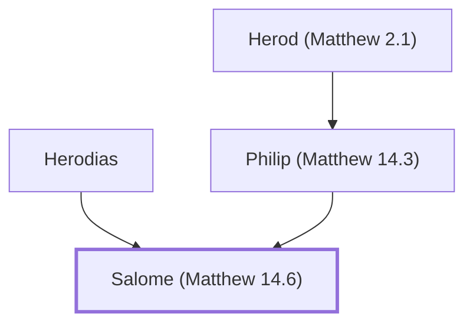

# Salome (Matthew 14.6)

Danced for Herod, requested John the Baptist's execution

*Not named in the text. Included because a family line passes through this person.*

**Original-language names:** . (G2266H)

## Family

- **Father:** [[connections/people/Philip (Matthew 14.3)|Philip (Matthew 14.3)]]
- **Mother:** [[connections/people/Herodias|Herodias]]

**Line of descent** (3 generations, father to son): [[connections/people/Herod (Matthew 2.1)|Herod (Matthew 2.1)]] → [[connections/people/Philip (Matthew 14.3)|Philip (Matthew 14.3)]] → **Salome (Matthew 14.6)**

**Family group:** [[connections/genealogy/Family of Herod (Matthew 2.1)|Family of Herod (Matthew 2.1)]], generation 3

## Mentioned in

[[connections/chapters/40-matthew/Matthew 14|Matthew 14]]
