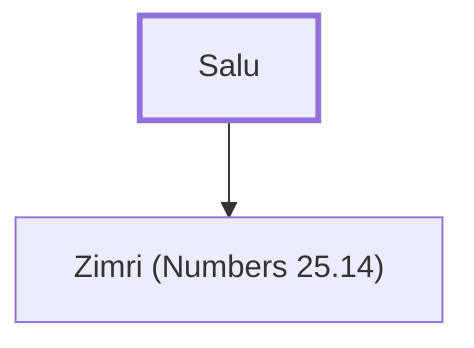

# Salu

Father of Zimri, a Simeonite prince

**Original-language names:** סַלוּא (H5543c)

## When

- **Placed around:** [[connections/timeline/15th century BC|1452 BC]] *(Ussher: the median date of the passages naming them)*

## Family

- **Children:** [[connections/people/Zimri (Numbers 25.14)|Zimri (Numbers 25.14)]]

**Family group:** [[connections/genealogy/Family of Salu|Family of Salu]], generation 1

## Appears in

[[connections/chapters/04-numbers/Numbers 25|Numbers 25]]

## Appears in the same verse as

[[connections/people/Simeon (Genesis 29.33)|Simeon (Genesis 29.33)]] · [[connections/people/Zimri (Numbers 25.14)|Zimri (Numbers 25.14)]]
