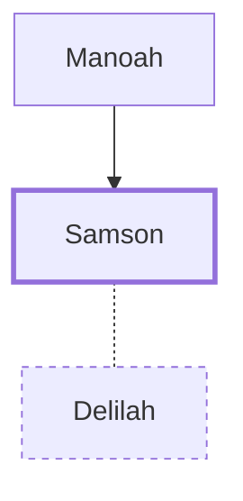

# Samson

Israelite judge with great strength from God

**Original-language names:** שִׁמְשׁוֹן (H8123) · Σαμψών (G4546)

## When

- **Lived:** ? – [[connections/timeline/12th century BC|1101 BC]] *(Jones)*
- **Placed around:** [[connections/timeline/12th century BC|1120 BC]] *(Ussher: the median date of the passages naming them)*

## Family

- **Father:** [[connections/people/Manoah|Manoah]]
- **Spouses:** [[connections/people/Delilah|Delilah]]

**Family group:** [[connections/genealogy/Family of Manoah|Family of Manoah]], generation 2

## Events

- [[connections/timeline/12th century BC|1141 BC]] · [[connections/events/Philistine Dominion|Philistine Dominion]]
- [[connections/timeline/12th century BC|1121 BC]] · [[connections/events/Judgeship of Samson|Judgeship of Samson]]
- [[connections/timeline/12th century BC|1101 BC]] · [[connections/events/Sampson destroys Temple of Dagon|Sampson destroys Temple of Dagon]]

## Appears in

[[connections/chapters/07-judges/Judges 13|Judges 13]] · [[connections/chapters/07-judges/Judges 14|Judges 14 (9)]] · [[connections/chapters/07-judges/Judges 15|Judges 15 (9)]] · [[connections/chapters/07-judges/Judges 16|Judges 16 (18)]] · [[connections/chapters/58-hebrews/Hebrews 11|Hebrews 11]]

## Appears in the same verse as

[[connections/people/Delilah|Delilah (4)]] · [[connections/people/Judah (Genesis 29.35)|Judah (Genesis 29.35) (2)]] · [[connections/places/Gaza|Gaza (2)]] · [[connections/places/Timnah (Genesis 38.12)|Timnah (Genesis 38.12) (2)]] · [[connections/people/Barak|Barak]] · [[connections/people/David|David]] · [[connections/people/Gideon|Gideon]] · [[connections/people/Jephthah|Jephthah]] · [[connections/people/Samuel|Samuel]] · [[connections/places/Etam (Judges 15.8)|Etam (Judges 15.8)]] · [[connections/places/Hebron|Hebron]]
