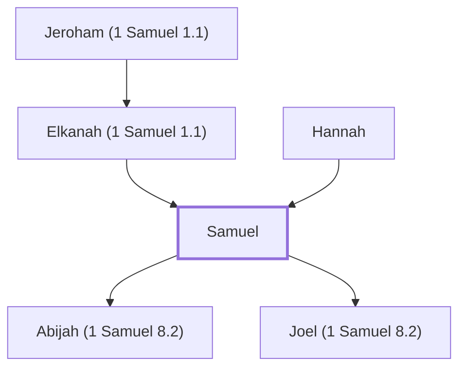

# Samuel

Prophet and last judge of Israel before the kings

**Original-language names:** שְׁמוּאֵל (H8050) · Σαμουήλ (G4545)

## When

- **Lived:** [[connections/timeline/12th century BC|1152 BC]] – [[connections/timeline/11th century BC|1060 BC]] *(Jones)*
- **Placed around:** [[connections/timeline/11th century BC|1095 BC]] *(Ussher: the median date of the passages naming them)*

## Family

- **Father:** [[connections/people/Elkanah (1 Samuel 1.1)|Elkanah (1 Samuel 1.1)]]
- **Mother:** [[connections/people/Hannah|Hannah]]
- **Children:** [[connections/people/Abijah (1 Samuel 8.2)|Abijah (1 Samuel 8.2)]], [[connections/people/Joel (1 Samuel 8.2)|Joel (1 Samuel 8.2)]]
- **Tribe or nation:** Tribe of Levi

**Line of descent** (43 generations, father to son): [[connections/people/Adam|Adam]] → [[connections/people/Seth|Seth]] → [[connections/people/Enosh|Enosh]] → [[connections/people/Kenan|Kenan]] → [[connections/people/Mahalalel (Genesis 5.12)|Mahalalel (Genesis 5.12)]] → [[connections/people/Jared|Jared]] → [[connections/people/Enoch (Genesis 5.18)|Enoch (Genesis 5.18)]] → [[connections/people/Methuselah|Methuselah]] → [[connections/people/Lamech (Genesis 5.25)|Lamech (Genesis 5.25)]] → [[connections/people/Noah (Genesis 5.29)|Noah (Genesis 5.29)]] → [[connections/people/Shem|Shem]] → [[connections/people/Arpachshad|Arpachshad]] → [[connections/people/Cainan|Cainan]] → [[connections/people/Shelah (Genesis 10.24)|Shelah (Genesis 10.24)]] → [[connections/people/Eber (Genesis 10.21)|Eber (Genesis 10.21)]] → [[connections/people/Peleg|Peleg]] → [[connections/people/Reu|Reu]] → [[connections/people/Serug|Serug]] → [[connections/people/Nahor (Genesis 11.22)|Nahor (Genesis 11.22)]] → [[connections/people/Terah|Terah]] → [[connections/people/Abraham|Abraham]] → [[connections/people/Isaac|Isaac]] → [[connections/people/Israel|Israel]] → [[connections/people/Levi (Genesis 29.34)|Levi (Genesis 29.34)]] → [[connections/people/Kohath|Kohath]] → [[connections/people/Izhar (Exodus 6.18)|Izhar (Exodus 6.18)]] → [[connections/people/Korah (Exodus 6.21)|Korah (Exodus 6.21)]] → [[connections/people/Ebiasaph|Ebiasaph]] → [[connections/people/Assir (1 Chronicles 6.8)|Assir (1 Chronicles 6.8)]] → [[connections/people/Tahath (1 Chronicles 6.9)|Tahath (1 Chronicles 6.9)]] → [[connections/people/Uriel (1 Chronicles 6.9)|Uriel (1 Chronicles 6.9)]] → [[connections/people/Uzziah (1 Chronicles 6.9)|Uzziah (1 Chronicles 6.9)]] → [[connections/people/Shaul (1 Chronicles 6.9)|Shaul (1 Chronicles 6.9)]] → [[connections/people/Elkanah (1 Chronicles 6.10)|Elkanah (1 Chronicles 6.10)]] → [[connections/people/Amasai (1 Chronicles 6.10)|Amasai (1 Chronicles 6.10)]] → [[connections/people/Ahimoth|Ahimoth]] → [[connections/people/Elkanah (1 Chronicles 6.11)|Elkanah (1 Chronicles 6.11)]] → [[connections/people/Zuph|Zuph]] → [[connections/people/Tohu|Tohu]] → [[connections/people/Elihu (1 Samuel 1.1)|Elihu (1 Samuel 1.1)]] → [[connections/people/Jeroham (1 Samuel 1.1)|Jeroham (1 Samuel 1.1)]] → [[connections/people/Elkanah (1 Samuel 1.1)|Elkanah (1 Samuel 1.1)]] → **Samuel**

**Family group:** [[connections/genealogy/Family of Adam|Family of Adam]], generation 43

## Appears in

[[connections/chapters/09-1-samuel/1 Samuel 1|1 Samuel 1]] · [[connections/chapters/09-1-samuel/1 Samuel 2|1 Samuel 2 (3)]] · [[connections/chapters/09-1-samuel/1 Samuel 3|1 Samuel 3 (15)]] · [[connections/chapters/09-1-samuel/1 Samuel 4|1 Samuel 4]] · [[connections/chapters/09-1-samuel/1 Samuel 7|1 Samuel 7 (9)]] · [[connections/chapters/09-1-samuel/1 Samuel 8|1 Samuel 8 (8)]] · [[connections/chapters/09-1-samuel/1 Samuel 9|1 Samuel 9 (10)]] · [[connections/chapters/09-1-samuel/1 Samuel 10|1 Samuel 10 (9)]] · [[connections/chapters/09-1-samuel/1 Samuel 11|1 Samuel 11 (3)]] · [[connections/chapters/09-1-samuel/1 Samuel 12|1 Samuel 12 (6)]] · [[connections/chapters/09-1-samuel/1 Samuel 13|1 Samuel 13 (5)]] · [[connections/chapters/09-1-samuel/1 Samuel 15|1 Samuel 15 (19)]] · [[connections/chapters/09-1-samuel/1 Samuel 16|1 Samuel 16 (8)]] · [[connections/chapters/09-1-samuel/1 Samuel 19|1 Samuel 19 (4)]] · [[connections/chapters/09-1-samuel/1 Samuel 25|1 Samuel 25]] · [[connections/chapters/09-1-samuel/1 Samuel 28|1 Samuel 28 (7)]] · [[connections/chapters/13-1-chronicles/1 Chronicles 6|1 Chronicles 6 (2)]] · [[connections/chapters/13-1-chronicles/1 Chronicles 9|1 Chronicles 9]] · [[connections/chapters/13-1-chronicles/1 Chronicles 11|1 Chronicles 11]] · [[connections/chapters/13-1-chronicles/1 Chronicles 26|1 Chronicles 26]] · [[connections/chapters/13-1-chronicles/1 Chronicles 29|1 Chronicles 29]] · [[connections/chapters/14-2-chronicles/2 Chronicles 35|2 Chronicles 35]] · [[connections/chapters/19-psalms/Psalms 99|Psalms 99]] · [[connections/chapters/24-jeremiah/Jeremiah 15|Jeremiah 15]] · [[connections/chapters/44-acts/Acts 3|Acts 3]] · [[connections/chapters/44-acts/Acts 13|Acts 13]] · [[connections/chapters/58-hebrews/Hebrews 11|Hebrews 11]]

## Appears in the same verse as

[[connections/people/Saul|Saul (39)]] · [[connections/people/Israel|Israel (28)]] · [[connections/places/Mizpah|Mizpah (11)]] · [[connections/people/David|David (9)]] · [[connections/people/Eli|Eli (6)]] · [[connections/places/Gilgal (Deuteronomy 11.30)|Gilgal (Deuteronomy 11.30) (5)]] · [[connections/people/Jesse|Jesse (4)]] · [[connections/people/Agag (1 Samuel 15.8)|Agag (1 Samuel 15.8) (3)]] · [[connections/people/Moses|Moses (3)]] · [[connections/people/Aaron|Aaron (2)]] · [[connections/people/Barak|Barak (2)]] · [[connections/people/Benjamin (Genesis 35.18)|Benjamin (Genesis 35.18) (2)]] · [[connections/people/Gideon|Gideon (2)]] · [[connections/people/Hannah|Hannah (2)]] · [[connections/people/Jephthah|Jephthah (2)]] · [[connections/people/Joel (1 Samuel 8.2)|Joel (1 Samuel 8.2) (2)]] · [[connections/places/Amalek|Amalek (2)]] · [[connections/places/Ebenezer|Ebenezer (2)]] · [[connections/places/Gibeah (Joshua 18.28)|Gibeah (Joshua 18.28) (2)]] · [[connections/places/Naioth|Naioth (2)]] · [[connections/people/Abijah (1 Samuel 8.2)|Abijah (1 Samuel 8.2)]] · [[connections/people/Abinadab (1 Samuel 16.8)|Abinadab (1 Samuel 16.8)]] · [[connections/people/Abner|Abner]] · [[connections/people/Gad (1 Samuel 22.5)|Gad (1 Samuel 22.5)]] · [[connections/people/Heman (1 Chronicles 6.18)|Heman (1 Chronicles 6.18)]] · [[connections/people/Joab (1 Samuel 26.6)|Joab (1 Samuel 26.6)]] · [[connections/people/Josiah (1 Kings 13.2)|Josiah (1 Kings 13.2)]] · [[connections/people/Judah (Genesis 29.35)|Judah (Genesis 29.35)]] · [[connections/people/Kish (1 Samuel 9.1)|Kish (1 Samuel 9.1)]] · [[connections/people/Nathan (2 Samuel 7.2)|Nathan (2 Samuel 7.2)]] · [[connections/people/Ner|Ner]] · [[connections/people/Samson|Samson]] · [[connections/people/Shelomoth (1 Chronicles 26.25)|Shelomoth (1 Chronicles 26.25)]] · [[connections/people/Zeruiah|Zeruiah]] · [[connections/places/Aphek (Joshua 12.18)|Aphek (Joshua 12.18)]] · [[connections/places/Beersheba|Beersheba]] · [[connections/places/Bethlehem (Genesis 35.16)|Bethlehem (Genesis 35.16)]] · [[connections/places/Carmel|Carmel]] · [[connections/places/Dan|Dan]] · [[connections/places/Egypt|Egypt]] · [[connections/places/Hebron|Hebron]] · [[connections/places/Jerusalem|Jerusalem]] · [[connections/places/Michmash|Michmash]] · [[connections/places/Paran|Paran]] · [[connections/places/Secu|Secu]] · [[connections/places/Shen|Shen]] · [[connections/places/Shiloh|Shiloh]]
