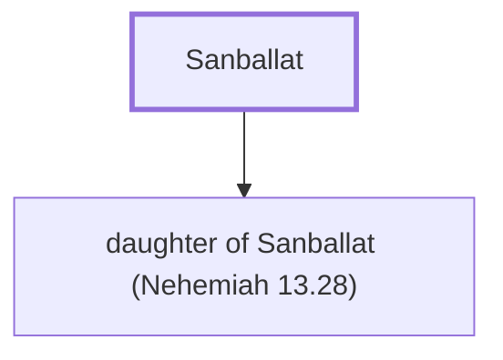

# Sanballat

Governor of Samaria, opposed Nehemiah's rebuilding of Jerusalem

**Original-language names:** סַנְבַלַּט (H5571)

## When

- **Placed around:** [[connections/timeline/5th century BC|445 BC]] *(Ussher: the median date of the passages naming them)*

## Family

- **Children:** [[connections/people/daughter of Sanballat (Nehemiah 13.28)|daughter of Sanballat (Nehemiah 13.28)]]

**Family group:** [[connections/genealogy/Family of Sanballat|Family of Sanballat]], generation 1

## Appears in

[[connections/chapters/16-nehemiah/Nehemiah 2|Nehemiah 2 (2)]] · [[connections/chapters/16-nehemiah/Nehemiah 3|Nehemiah 3]] · [[connections/chapters/16-nehemiah/Nehemiah 4|Nehemiah 4]] · [[connections/chapters/16-nehemiah/Nehemiah 6|Nehemiah 6 (5)]] · [[connections/chapters/16-nehemiah/Nehemiah 13|Nehemiah 13]]

## Appears in the same verse as

[[connections/people/Tobiah (Nehemiah 2.10)|Tobiah (Nehemiah 2.10) (6)]] · [[connections/people/Geshem|Geshem (3)]] · [[connections/people/Eliashib (Nehemiah 12.10)|Eliashib (Nehemiah 12.10)]] · [[connections/people/Israel|Israel]] · [[connections/people/Joiada (Nehemiah 12.10)|Joiada (Nehemiah 12.10)]] · [[connections/people/Noadiah (Nehemiah 6.14)|Noadiah (Nehemiah 6.14)]] · [[connections/places/Jerusalem|Jerusalem]] · [[connections/places/Ono|Ono]]
