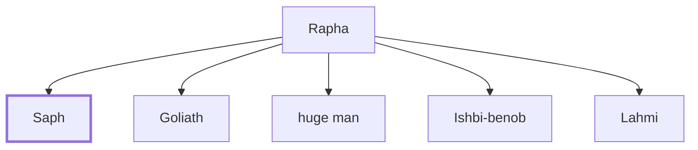

# Saph

Philistine giant killed by Sibbechai the Hushathite

**Also called:** Sippai

**Original-language names:** סַף (H5593) · סִפַּי (H5598)

## When

- **Placed around:** [[connections/timeline/11th century BC|1018 BC]] *(Ussher: the median date of the passages naming them)*

## Family

- **Father:** [[connections/people/Rapha|Rapha]]
- **Brothers and sisters:** [[connections/people/Goliath|Goliath]], [[connections/people/huge man|huge man]], [[connections/people/Ishbi-benob|Ishbi-benob]], [[connections/people/Lahmi|Lahmi]]

**Family group:** [[connections/genealogy/Family of Rapha|Family of Rapha]], generation 2

## Appears in

[[connections/chapters/10-2-samuel/2 Samuel 21|2 Samuel 21]] · [[connections/chapters/13-1-chronicles/1 Chronicles 20|1 Chronicles 20]]

## Appears in the same verse as

[[connections/people/Sibbecai|Sibbecai (2)]] · [[connections/places/Gezer|Gezer (2)]] · [[connections/people/Rapha|Rapha]]
