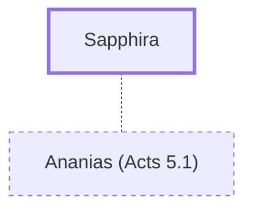

# Sapphira

Wife of Ananias, lied to the apostles, died

**Original-language names:** Σαπφείρη (G4551)

## When

- **Placed around:** [[connections/timeline/1st century AD|AD 33]] *(Ussher: the median date of the passages naming them)*

## Family

- **Spouses:** [[connections/people/Ananias (Acts 5.1)|Ananias (Acts 5.1)]]

## Events

- [[connections/timeline/1st century AD|AD 30]] · [[connections/events/Ananias and Sapphira lie to God|Ananias and Sapphira lie to God]]

## Appears in

[[connections/chapters/44-acts/Acts 5|Acts 5]]

## Appears in the same verse as

[[connections/people/Ananias (Acts 5.1)|Ananias (Acts 5.1)]]
