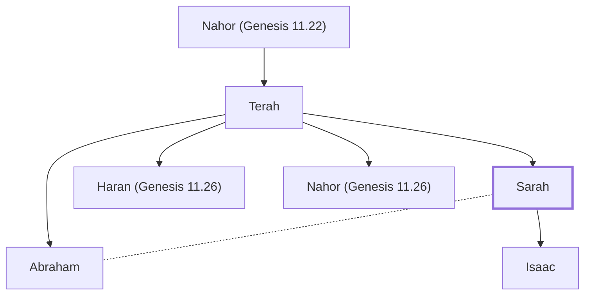

# Sarah

Wife of Abraham; mother of Isaac

**Also called:** Sarai

**Original-language names:** שָׂרָה (H8283) · שָׂרַי (H8297) · Σάρρα (G4564)

## When

- **Lived:** [[connections/timeline/20th century BC|1987 BC]] – [[connections/timeline/19th century BC|1860 BC]] *(Jones)*
- **Placed around:** [[connections/timeline/19th century BC|1897 BC]] *(Ussher: the median date of the passages naming them)*

## Family

- **Father:** [[connections/people/Terah|Terah]]
- **Brothers and sisters:** [[connections/people/Abraham|Abraham]], [[connections/people/Haran (Genesis 11.26)|Haran (Genesis 11.26)]], [[connections/people/Nahor (Genesis 11.26)|Nahor (Genesis 11.26)]]
- **Spouses:** [[connections/people/Abraham|Abraham]]
- **Children:** [[connections/people/Isaac|Isaac]]
- **Tribe or nation:** Early Patriarch

**Line of descent** (21 generations, father to son): [[connections/people/Adam|Adam]] → [[connections/people/Seth|Seth]] → [[connections/people/Enosh|Enosh]] → [[connections/people/Kenan|Kenan]] → [[connections/people/Mahalalel (Genesis 5.12)|Mahalalel (Genesis 5.12)]] → [[connections/people/Jared|Jared]] → [[connections/people/Enoch (Genesis 5.18)|Enoch (Genesis 5.18)]] → [[connections/people/Methuselah|Methuselah]] → [[connections/people/Lamech (Genesis 5.25)|Lamech (Genesis 5.25)]] → [[connections/people/Noah (Genesis 5.29)|Noah (Genesis 5.29)]] → [[connections/people/Shem|Shem]] → [[connections/people/Arpachshad|Arpachshad]] → [[connections/people/Cainan|Cainan]] → [[connections/people/Shelah (Genesis 10.24)|Shelah (Genesis 10.24)]] → [[connections/people/Eber (Genesis 10.21)|Eber (Genesis 10.21)]] → [[connections/people/Peleg|Peleg]] → [[connections/people/Reu|Reu]] → [[connections/people/Serug|Serug]] → [[connections/people/Nahor (Genesis 11.22)|Nahor (Genesis 11.22)]] → [[connections/people/Terah|Terah]] → **Sarah**

**Family group:** [[connections/genealogy/Family of Adam|Family of Adam]], generation 21

## Events

- [[connections/timeline/20th century BC|1921 BC]] · [[connections/events/Abraham enters Canaan|Abraham enters Canaan]]
- [[connections/timeline/20th century BC|1921 BC]] · [[connections/events/Abraham goes to Egypt|Abraham goes to Egypt]]
- [[connections/timeline/20th century BC|1921 BC]] · [[connections/events/Sojourn in Canaan and Egypt|Sojourn in Canaan and Egypt]]
- [[connections/timeline/19th century BC|1896 BC]] · [[connections/events/Birth of Isaac|Birth of Isaac]]

## Appears in

[[connections/chapters/01-genesis/Genesis 11|Genesis 11 (3)]] · [[connections/chapters/01-genesis/Genesis 12|Genesis 12 (3)]] · [[connections/chapters/01-genesis/Genesis 16|Genesis 16 (6)]] · [[connections/chapters/01-genesis/Genesis 17|Genesis 17 (4)]] · [[connections/chapters/01-genesis/Genesis 18|Genesis 18 (8)]] · [[connections/chapters/01-genesis/Genesis 20|Genesis 20 (4)]] · [[connections/chapters/01-genesis/Genesis 21|Genesis 21 (7)]] · [[connections/chapters/01-genesis/Genesis 23|Genesis 23 (3)]] · [[connections/chapters/01-genesis/Genesis 24|Genesis 24 (2)]] · [[connections/chapters/01-genesis/Genesis 25|Genesis 25 (2)]] · [[connections/chapters/01-genesis/Genesis 49|Genesis 49]] · [[connections/chapters/23-isaiah/Isaiah 51|Isaiah 51]] · [[connections/chapters/45-romans/Romans 4|Romans 4]] · [[connections/chapters/45-romans/Romans 9|Romans 9]] · [[connections/chapters/58-hebrews/Hebrews 11|Hebrews 11]] · [[connections/chapters/60-1-peter/1 Peter 3|1 Peter 3]]

## Appears in the same verse as

[[connections/people/Abraham|Abraham (29)]] · [[connections/people/Isaac|Isaac (6)]] · [[connections/people/Hagar|Hagar (5)]] · [[connections/places/Canaan|Canaan (5)]] · [[connections/people/Abimelech (Genesis 20.2)|Abimelech (Genesis 20.2) (3)]] · [[connections/people/Haran (Genesis 11.26)|Haran (Genesis 11.26) (2)]] · [[connections/people/Lot|Lot (2)]] · [[connections/people/Rebekah|Rebekah (2)]] · [[connections/places/Haran|Haran (2)]] · [[connections/places/Hebron|Hebron (2)]] · [[connections/people/Heth|Heth]] · [[connections/people/Iscah|Iscah]] · [[connections/people/Ishmael (Genesis 16.11)|Ishmael (Genesis 16.11)]] · [[connections/people/Leah|Leah]] · [[connections/people/Milcah (Genesis 11.29)|Milcah (Genesis 11.29)]] · [[connections/people/Nahor (Genesis 11.26)|Nahor (Genesis 11.26)]] · [[connections/people/Pharaoh (Genesis 12.15)|Pharaoh (Genesis 12.15)]] · [[connections/people/Terah|Terah]] · [[connections/places/Chaldea|Chaldea]] · [[connections/places/Egypt|Egypt]] · [[connections/places/Gerar|Gerar]] · [[connections/places/Machpelah|Machpelah]] · [[connections/places/Mamre|Mamre]] · [[connections/places/Ur|Ur]]
