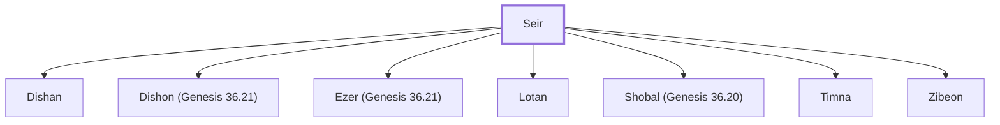

# Seir

Horite chief, ancestor of the Horites of Seir

**Original-language names:** שֵׂעִיר (H8165b)

## When

- **Placed around:** [[connections/timeline/19th century BC|1806 BC]] *(Ussher: the median date of the passages naming them)*

## Family

- **Children:** [[connections/people/Dishan|Dishan]], [[connections/people/Dishon (Genesis 36.21)|Dishon (Genesis 36.21)]], [[connections/people/Ezer (Genesis 36.21)|Ezer (Genesis 36.21)]], [[connections/people/Lotan|Lotan]], [[connections/people/Shobal (Genesis 36.20)|Shobal (Genesis 36.20)]], [[connections/people/Timna|Timna]], [[connections/people/Zibeon|Zibeon]]
- **Tribe or nation:** Edom

**Family group:** [[connections/genealogy/Family of Adam|Family of Adam]], generation 1

## Appears in

[[connections/chapters/01-genesis/Genesis 36|Genesis 36 (2)]] · [[connections/chapters/13-1-chronicles/1 Chronicles 1|1 Chronicles 1]]

## Appears in the same verse as

[[connections/people/Anah|Anah (2)]] · [[connections/people/Dishan|Dishan (2)]] · [[connections/people/Dishon (Genesis 36.21)|Dishon (Genesis 36.21) (2)]] · [[connections/people/Ezer (Genesis 36.21)|Ezer (Genesis 36.21) (2)]] · [[connections/people/Lotan|Lotan (2)]] · [[connections/people/Shobal (Genesis 36.20)|Shobal (Genesis 36.20) (2)]] · [[connections/people/Esau|Esau]]
