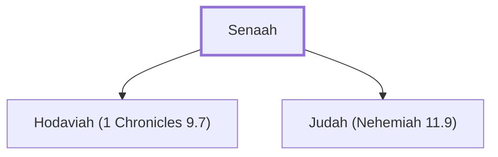

# Senaah

A leader from the tribe of Benjamin

**Also called:** Hassenuah

**Original-language names:** סְנָאָה (H5570) · הַסְּנוּאָה (H5574)

## When

- **Placed around:** [[connections/timeline/5th century BC|445 BC]] *(Ussher: the median date of the passages naming them)*

## Family

- **Children:** [[connections/people/Hodaviah (1 Chronicles 9.7)|Hodaviah (1 Chronicles 9.7) (descendants)]], [[connections/people/Judah (Nehemiah 11.9)|Judah (Nehemiah 11.9) (descendants)]]
- **Tribe or nation:** Tribe of Benjamin

**Family group:** [[connections/genealogy/Family of Senaah|Family of Senaah]], generation 1

## Appears in

[[connections/chapters/15-ezra/Ezra 2|Ezra 2]] · [[connections/chapters/16-nehemiah/Nehemiah 7|Nehemiah 7]] · [[connections/chapters/16-nehemiah/Nehemiah 11|Nehemiah 11]]

## Appears in the same verse as

[[connections/people/Joel (Nehemiah 11.9)|Joel (Nehemiah 11.9)]] · [[connections/people/Judah (Nehemiah 11.9)|Judah (Nehemiah 11.9)]] · [[connections/people/Zichri (Nehemiah 11.9)|Zichri (Nehemiah 11.9)]]
