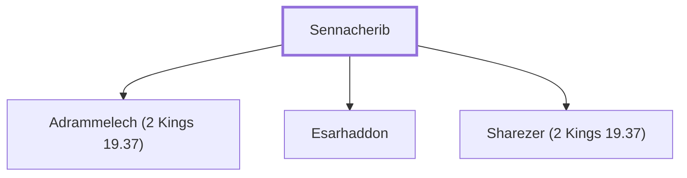

# Sennacherib

Assyrian Emperor who invaded Judah

**Also called:** Sargon

**Original-language names:** סַנְחֵרִיב (H5576) · סַרְגוֹן (H5623)

## When

- **Placed around:** [[connections/timeline/8th century BC|710 BC]] *(Ussher: the median date of the passages naming them)*
- **Reigned / in office:** [[connections/timeline/8th century BC|705 BC]] – [[connections/timeline/7th century BC|681 BC]] *(modern dates)* · Sennacherib, Assyria · [Wikidata Q207140](https://www.wikidata.org/wiki/Q207140)

## Family

- **Children:** [[connections/people/Adrammelech (2 Kings 19.37)|Adrammelech (2 Kings 19.37)]], [[connections/people/Esarhaddon|Esarhaddon]], [[connections/people/Sharezer (2 Kings 19.37)|Sharezer (2 Kings 19.37)]]
- **Tribe or nation:** Mesopotamia

**Family group:** [[connections/genealogy/Family of Sennacherib|Family of Sennacherib]], generation 1

## Appears in

[[connections/chapters/12-2-kings/2 Kings 18|2 Kings 18]] · [[connections/chapters/12-2-kings/2 Kings 19|2 Kings 19 (3)]] · [[connections/chapters/14-2-chronicles/2 Chronicles 32|2 Chronicles 32 (5)]] · [[connections/chapters/23-isaiah/Isaiah 20|Isaiah 20]] · [[connections/chapters/23-isaiah/Isaiah 36|Isaiah 36]] · [[connections/chapters/23-isaiah/Isaiah 37|Isaiah 37 (3)]]

## Appears in the same verse as

[[connections/places/Assyria|Assyria (11)]] · [[connections/people/Hezekiah (2 Kings 16.20)|Hezekiah (2 Kings 16.20) (7)]] · [[connections/people/Judah (Genesis 29.35)|Judah (Genesis 29.35) (4)]] · [[connections/places/Jerusalem|Jerusalem (4)]] · [[connections/people/Amoz|Amoz (2)]] · [[connections/people/Isaiah|Isaiah (2)]] · [[connections/people/Israel|Israel (2)]] · [[connections/places/Nineveh|Nineveh (2)]] · [[connections/people/Tartan|Tartan]] · [[connections/places/Ashdod|Ashdod]] · [[connections/places/Lachish|Lachish]]
