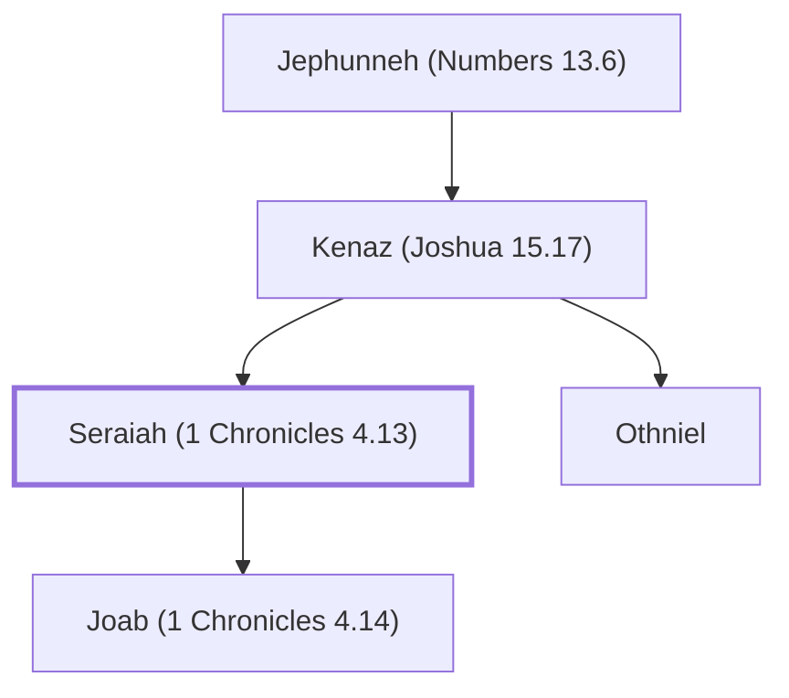

# Seraiah (1 Chronicles 4.13)

Son of Kenaz; father of Joab

**Original-language names:** שְׂרָיָהוּ (H8304)

## When

- **Placed around:** [[connections/timeline/18th century BC|1721 BC]] *(Ussher: the median date of the passages naming them)*

## Family

- **Father:** [[connections/people/Kenaz (Joshua 15.17)|Kenaz (Joshua 15.17)]]
- **Brothers and sisters:** [[connections/people/Othniel|Othniel]]
- **Children:** [[connections/people/Joab (1 Chronicles 4.14)|Joab (1 Chronicles 4.14)]]
- **Tribe or nation:** Tribe of Judah

**Line of descent** (3 generations, father to son): [[connections/people/Jephunneh (Numbers 13.6)|Jephunneh (Numbers 13.6)]] → [[connections/people/Kenaz (Joshua 15.17)|Kenaz (Joshua 15.17)]] → **Seraiah (1 Chronicles 4.13)**

**Family group:** [[connections/genealogy/Family of Jephunneh (Numbers 13.6)|Family of Jephunneh (Numbers 13.6)]], generation 3

## Appears in

[[connections/chapters/13-1-chronicles/1 Chronicles 4|1 Chronicles 4 (2)]]

## Appears in the same verse as

[[connections/people/Hathath|Hathath]] · [[connections/people/Joab (1 Chronicles 4.14)|Joab (1 Chronicles 4.14)]] · [[connections/people/Kenaz (Joshua 15.17)|Kenaz (Joshua 15.17)]] · [[connections/people/Meonothai|Meonothai]] · [[connections/people/Ophrah|Ophrah]] · [[connections/people/Othniel|Othniel]] · [[connections/places/Ge-harashim|Ge-harashim]]
