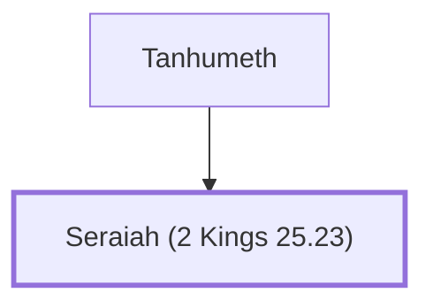

# Seraiah (2 Kings 25.23)

Officer under Gedaliah, son of Tanhumeth the Netophathite

**Original-language names:** שְׂרָיָהוּ (H8304)

## When

- **Placed around:** [[connections/timeline/6th century BC|588 BC]] *(Ussher: the median date of the passages naming them)*

## Family

- **Father:** [[connections/people/Tanhumeth|Tanhumeth]]
- **Tribe or nation:** Tribe of Judah(?)

**Family group:** [[connections/genealogy/Family of Tanhumeth|Family of Tanhumeth]], generation 2

## Appears in

[[connections/chapters/12-2-kings/2 Kings 25|2 Kings 25]] · [[connections/chapters/24-jeremiah/Jeremiah 40|Jeremiah 40]]

## Appears in the same verse as

[[connections/people/Gedaliah (2 Kings 25.22)|Gedaliah (2 Kings 25.22) (2)]] · [[connections/people/Ishmael (2 Kings 25.23)|Ishmael (2 Kings 25.23) (2)]] · [[connections/people/Jezaniah|Jezaniah (2)]] · [[connections/people/Johanan (2 Kings 25.23)|Johanan (2 Kings 25.23) (2)]] · [[connections/people/Kareah|Kareah (2)]] · [[connections/people/Nethaniah (2 Kings 25.23)|Nethaniah (2 Kings 25.23) (2)]] · [[connections/people/Tanhumeth|Tanhumeth (2)]] · [[connections/places/Mizpah|Mizpah (2)]] · [[connections/people/Ephai|Ephai]] · [[connections/people/Jonathan (Jeremiah 40.8)|Jonathan (Jeremiah 40.8)]] · [[connections/places/Babylon|Babylon]]
