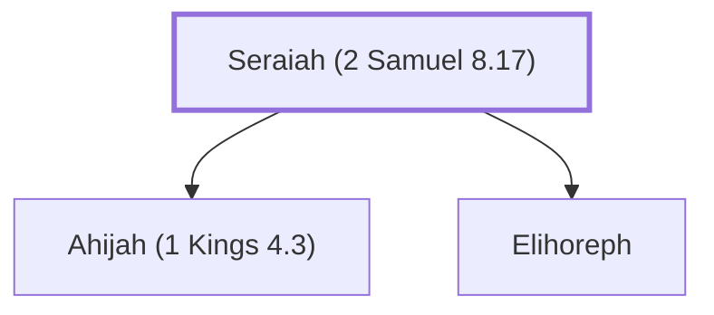

# Seraiah (2 Samuel 8.17)

David's scribe, also known as Shavsha, Sheva, Sheya, or Shisha

**Also called:** Shavsha, Sheva, Sheya, Shisha

**Original-language names:** שְׂרָיָהוּ (H8304) · שַׁוְשָׁא (H7798) · שְׁוָא (H7724) · שְׁיָא (H7864) · שִׁישָׁא (H7894)

## When

- **Placed around:** [[connections/timeline/11th century BC|1022 BC]] *(Ussher: the median date of the passages naming them)*

## Family

- **Children:** [[connections/people/Ahijah (1 Kings 4.3)|Ahijah (1 Kings 4.3)]], [[connections/people/Elihoreph|Elihoreph]]

**Family group:** [[connections/genealogy/Family of Seraiah (2 Samuel 8.17)|Family of Seraiah (2 Samuel 8.17)]], generation 1

## Appears in

[[connections/chapters/10-2-samuel/2 Samuel 8|2 Samuel 8]] · [[connections/chapters/10-2-samuel/2 Samuel 20|2 Samuel 20]] · [[connections/chapters/11-1-kings/1 Kings 4|1 Kings 4]] · [[connections/chapters/13-1-chronicles/1 Chronicles 18|1 Chronicles 18]]

## Appears in the same verse as

[[connections/people/Abiathar|Abiathar (3)]] · [[connections/people/Zadok (2 Samuel 8.17)|Zadok (2 Samuel 8.17) (3)]] · [[connections/people/Ahimelech (2 Samuel 8.17)|Ahimelech (2 Samuel 8.17) (2)]] · [[connections/people/Ahitub (2 Samuel 8.17)|Ahitub (2 Samuel 8.17) (2)]] · [[connections/people/Ahijah (1 Kings 4.3)|Ahijah (1 Kings 4.3)]] · [[connections/people/Ahilud|Ahilud]] · [[connections/people/Elihoreph|Elihoreph]] · [[connections/people/Jehoshaphat (2 Samuel 8.16)|Jehoshaphat (2 Samuel 8.16)]]
