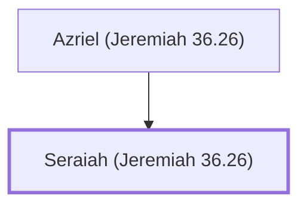

# Seraiah (Jeremiah 36.26)

Son of Azriel, sent to capture Jeremiah and Baruch

**Original-language names:** שְׂרָיָהוּ (H8304)

## When

- **Placed around:** [[connections/timeline/7th century BC|606 BC]] *(Ussher: the median date of the passages naming them)*

## Family

- **Father:** [[connections/people/Azriel (Jeremiah 36.26)|Azriel (Jeremiah 36.26)]]

**Family group:** [[connections/genealogy/Family of Azriel (Jeremiah 36.26)|Family of Azriel (Jeremiah 36.26)]], generation 2

## Appears in

[[connections/chapters/24-jeremiah/Jeremiah 36|Jeremiah 36]]

## Appears in the same verse as

[[connections/people/Abdeel|Abdeel]] · [[connections/people/Azriel (Jeremiah 36.26)|Azriel (Jeremiah 36.26)]] · [[connections/people/Baruch (Jeremiah 32.12)|Baruch (Jeremiah 32.12)]] · [[connections/people/Hammelech|Hammelech]] · [[connections/people/Jerahmeel (Jeremiah 36.26)|Jerahmeel (Jeremiah 36.26)]] · [[connections/people/Jeremiah (2 Chronicles 35.25)|Jeremiah (2 Chronicles 35.25)]] · [[connections/people/Shelemiah (Jeremiah 36.26)|Shelemiah (Jeremiah 36.26)]]
