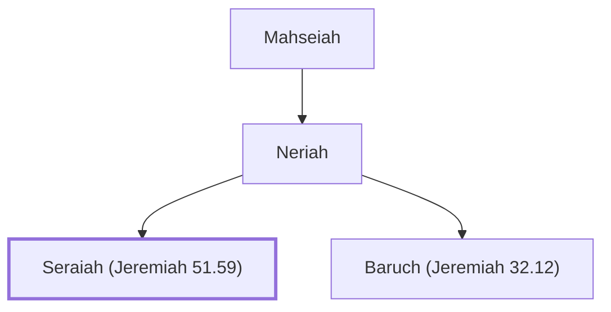

# Seraiah (Jeremiah 51.59)

Neriah's son, Baruch's brother, accompanied Zedekiah to Babylon

**Original-language names:** שְׂרָיָהוּ (H8304)

## When

- **Placed around:** [[connections/timeline/6th century BC|595 BC]] *(Ussher: the median date of the passages naming them)*

## Family

- **Father:** [[connections/people/Neriah|Neriah]]
- **Brothers and sisters:** [[connections/people/Baruch (Jeremiah 32.12)|Baruch (Jeremiah 32.12)]]

**Line of descent** (3 generations, father to son): [[connections/people/Mahseiah|Mahseiah]] → [[connections/people/Neriah|Neriah]] → **Seraiah (Jeremiah 51.59)**

**Family group:** [[connections/genealogy/Family of Mahseiah|Family of Mahseiah]], generation 3

## Appears in

[[connections/chapters/24-jeremiah/Jeremiah 51|Jeremiah 51 (2)]]

## Appears in the same verse as

[[connections/people/Jeremiah (2 Chronicles 35.25)|Jeremiah (2 Chronicles 35.25) (2)]] · [[connections/places/Babylon|Babylon (2)]] · [[connections/people/Judah (Genesis 29.35)|Judah (Genesis 29.35)]] · [[connections/people/Mahseiah|Mahseiah]] · [[connections/people/Neriah|Neriah]] · [[connections/people/Zedekiah (2 Kings 24.17)|Zedekiah (2 Kings 24.17)]]
