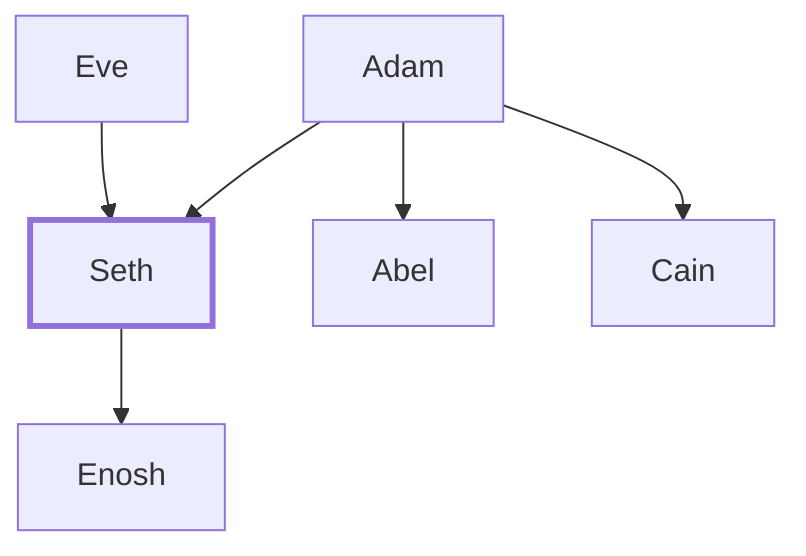

# Seth

Third son of Adam and Eve, ancestor of righteous line

**Also called:** Sheth

**Original-language names:** שֵׁת (H8352) · שֵׁת (H8351) · Σήθ (G4589)

## When

- **Lived:** [[connections/timeline/39th century BC|3874 BC]] – [[connections/timeline/30th century BC|2962 BC]] *(Jones)*
- **Placed around:** [[connections/timeline/38th century BC|3769 BC]] *(Ussher: the median date of the passages naming them)*

## Family

- **Father:** [[connections/people/Adam|Adam]]
- **Mother:** [[connections/people/Eve|Eve]]
- **Brothers and sisters:** [[connections/people/Abel|Abel]], [[connections/people/Cain|Cain]]
- **Children:** [[connections/people/Enosh|Enosh]]
- **Tribe or nation:** Early Patriarch

**Family group:** [[connections/genealogy/Family of Adam|Family of Adam]], generation 2

## Events

- [[connections/timeline/39th century BC|3874 BC]] · [[connections/events/Birth of Seth|Birth of Seth]]
- [[connections/timeline/39th century BC|3874 BC]] · [[connections/events/Lifetime of Seth|Lifetime of Seth]]
- [[connections/timeline/38th century BC|3769 BC]] · [[connections/events/Birth of Enos|Birth of Enos]]
- [[connections/timeline/30th century BC|2962 BC]] · [[connections/events/Death of Seth|Death of Seth]]

## Appears in

[[connections/chapters/01-genesis/Genesis 4|Genesis 4 (2)]] · [[connections/chapters/01-genesis/Genesis 5|Genesis 5 (5)]] · [[connections/chapters/04-numbers/Numbers 24|Numbers 24]] · [[connections/chapters/13-1-chronicles/1 Chronicles 1|1 Chronicles 1]] · [[connections/chapters/42-luke/Luke 3|Luke 3]]

## Appears in the same verse as

[[connections/people/Adam|Adam (5)]] · [[connections/people/Enosh|Enosh (5)]] · [[connections/people/Abel|Abel]] · [[connections/people/Cain|Cain]] · [[connections/people/Israel|Israel]] · [[connections/places/Moab|Moab]]
