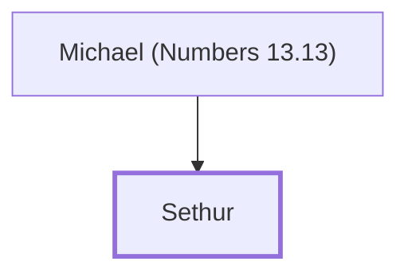

# Sethur

Son of Michael, spy from the tribe of Asher

**Original-language names:** סְתוּר (H5639)

## When

- **Placed around:** [[connections/timeline/15th century BC|1490 BC]] *(Ussher: the median date of the passages naming them)*

## Family

- **Father:** [[connections/people/Michael (Numbers 13.13)|Michael (Numbers 13.13)]]

**Family group:** [[connections/genealogy/Family of Michael (Numbers 13.13)|Family of Michael (Numbers 13.13)]], generation 2

## Appears in

[[connections/chapters/04-numbers/Numbers 13|Numbers 13]]

## Appears in the same verse as

[[connections/people/Asher|Asher]] · [[connections/people/Michael (Numbers 13.13)|Michael (Numbers 13.13)]]
