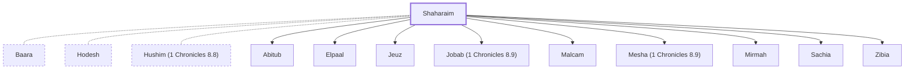

# Shaharaim

Benjamite who had wives Hushim and Baara

**Original-language names:** שַׁחֲרַ֫יִם (H7842)

## Family

- **Spouses:** [[connections/people/Baara|Baara]], [[connections/people/Hodesh|Hodesh]], [[connections/people/Hushim (1 Chronicles 8.8)|Hushim (1 Chronicles 8.8)]]
- **Children:** [[connections/people/Abitub|Abitub]], [[connections/people/Elpaal|Elpaal]], [[connections/people/Jeuz|Jeuz]], [[connections/people/Jobab (1 Chronicles 8.9)|Jobab (1 Chronicles 8.9)]], [[connections/people/Malcam|Malcam]], [[connections/people/Mesha (1 Chronicles 8.9)|Mesha (1 Chronicles 8.9)]], [[connections/people/Mirmah|Mirmah]], [[connections/people/Sachia|Sachia]], [[connections/people/Zibia|Zibia]]
- **Tribe or nation:** Tribe of Benjamin

**Family group:** [[connections/genealogy/Family of Shaharaim|Family of Shaharaim]], generation 1

## Appears in

[[connections/chapters/13-1-chronicles/1 Chronicles 8|1 Chronicles 8]]

## Appears in the same verse as

[[connections/people/Baara|Baara]] · [[connections/people/Hushim (1 Chronicles 8.8)|Hushim (1 Chronicles 8.8)]] · [[connections/places/Moab|Moab]]
