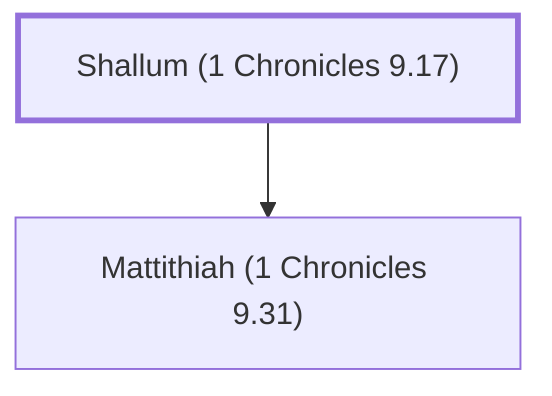

# Shallum (1 Chronicles 9.17)

Gatekeeper of the tabernacle during David's reign

**Original-language names:** שַׁלּוּם (H7967)

## When

- **Placed around:** [[connections/timeline/6th century BC|536 BC]] *(Ussher: the median date of the passages naming them)*

## Family

- **Children:** [[connections/people/Mattithiah (1 Chronicles 9.31)|Mattithiah (1 Chronicles 9.31)]]
- **Tribe or nation:** Tribe of Levi

**Family group:** [[connections/genealogy/Family of Shallum (1 Chronicles 9.17)|Family of Shallum (1 Chronicles 9.17)]], generation 1

## Appears in

[[connections/chapters/13-1-chronicles/1 Chronicles 9|1 Chronicles 9 (3)]] · [[connections/chapters/15-ezra/Ezra 2|Ezra 2]] · [[connections/chapters/16-nehemiah/Nehemiah 7|Nehemiah 7]]

## Appears in the same verse as

[[connections/people/Akkub (1 Chronicles 9.17)|Akkub (1 Chronicles 9.17) (3)]] · [[connections/people/Talmon|Talmon (3)]] · [[connections/people/Ater (Ezra 2.42)|Ater (Ezra 2.42) (2)]] · [[connections/people/Hatita|Hatita (2)]] · [[connections/people/Shobai|Shobai (2)]] · [[connections/people/Ahiman (1 Chronicles 9.17)|Ahiman (1 Chronicles 9.17)]] · [[connections/people/Ebiasaph|Ebiasaph]] · [[connections/people/Korah (Exodus 6.21)|Korah (Exodus 6.21)]] · [[connections/people/Kore (1 Chronicles 9.19)|Kore (1 Chronicles 9.19)]] · [[connections/people/Mattithiah (1 Chronicles 9.31)|Mattithiah (1 Chronicles 9.31)]]
