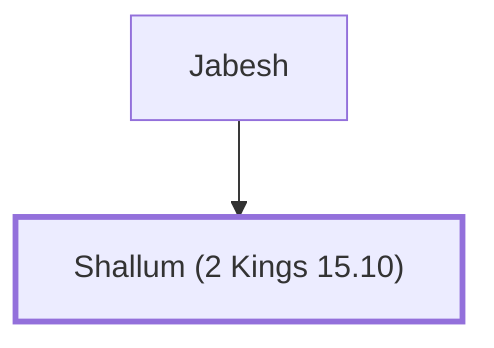

# Shallum (2 Kings 15.10)

King of Israel who conspired against Zechariah

**Original-language names:** שַׁלּוּם (H7967)

## When

- **Placed around:** [[connections/timeline/8th century BC|772 BC]] *(Ussher: the median date of the passages naming them)*

## Family

- **Father:** [[connections/people/Jabesh|Jabesh]]
- **Tribe or nation:** Israel

**Family group:** [[connections/genealogy/Family of Jabesh|Family of Jabesh]], generation 2

## Events

- [[connections/timeline/8th century BC|772 BC]] · [[connections/events/Reign of Shallum|Reign of Shallum]]
- [[connections/timeline/8th century BC|772 BC]] · [[connections/events/Death of Zachariah|Death of Zachariah]]
- [[connections/timeline/8th century BC|772 BC]] · [[connections/events/Death of Shallum|Death of Shallum]]

## Appears in

[[connections/chapters/12-2-kings/2 Kings 15|2 Kings 15 (4)]]

## Appears in the same verse as

[[connections/people/Jabesh|Jabesh (3)]] · [[connections/places/Samaria|Samaria (2)]] · [[connections/people/Gadi|Gadi]] · [[connections/people/Israel|Israel]] · [[connections/people/Judah (Genesis 29.35)|Judah (Genesis 29.35)]] · [[connections/people/Menahem|Menahem]] · [[connections/people/Uzziah (2 Kings 14.21)|Uzziah (2 Kings 14.21)]] · [[connections/places/Ibleam|Ibleam]] · [[connections/places/Tirzah|Tirzah]]
