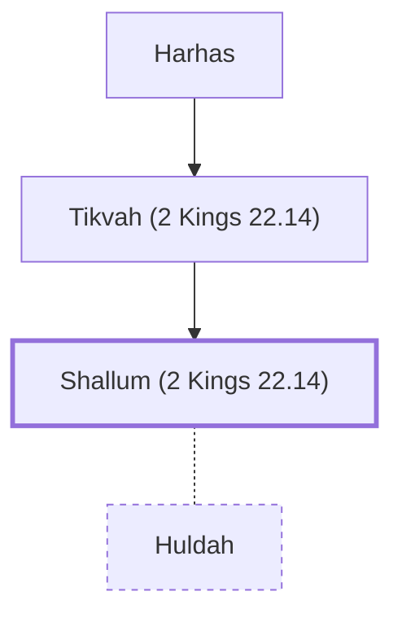

# Shallum (2 Kings 22.14)

Husband of Huldah the prophetess

**Original-language names:** שַׁלּוּם (H7967)

## When

- **Placed around:** [[connections/timeline/7th century BC|624 BC]] *(Ussher: the median date of the passages naming them)*

## Family

- **Father:** [[connections/people/Tikvah (2 Kings 22.14)|Tikvah (2 Kings 22.14)]]
- **Spouses:** [[connections/people/Huldah|Huldah]]

**Line of descent** (3 generations, father to son): [[connections/people/Harhas|Harhas]] → [[connections/people/Tikvah (2 Kings 22.14)|Tikvah (2 Kings 22.14)]] → **Shallum (2 Kings 22.14)**

**Family group:** [[connections/genealogy/Family of Harhas|Family of Harhas]], generation 3

## Appears in

[[connections/chapters/12-2-kings/2 Kings 22|2 Kings 22]] · [[connections/chapters/14-2-chronicles/2 Chronicles 34|2 Chronicles 34]]

## Appears in the same verse as

[[connections/people/Harhas|Harhas (2)]] · [[connections/people/Hilkiah (2 Kings 22.4)|Hilkiah (2 Kings 22.4) (2)]] · [[connections/people/Huldah|Huldah (2)]] · [[connections/people/Tikvah (2 Kings 22.14)|Tikvah (2 Kings 22.14) (2)]] · [[connections/places/Jerusalem|Jerusalem (2)]] · [[connections/places/Second Quarter|Second Quarter (2)]] · [[connections/people/Achbor (2 Kings 22.12)|Achbor (2 Kings 22.12)]] · [[connections/people/Ahikam|Ahikam]] · [[connections/people/Asaiah (2 Kings 22.12)|Asaiah (2 Kings 22.12)]] · [[connections/people/Shaphan (2 Kings 22.3)|Shaphan (2 Kings 22.3)]]
