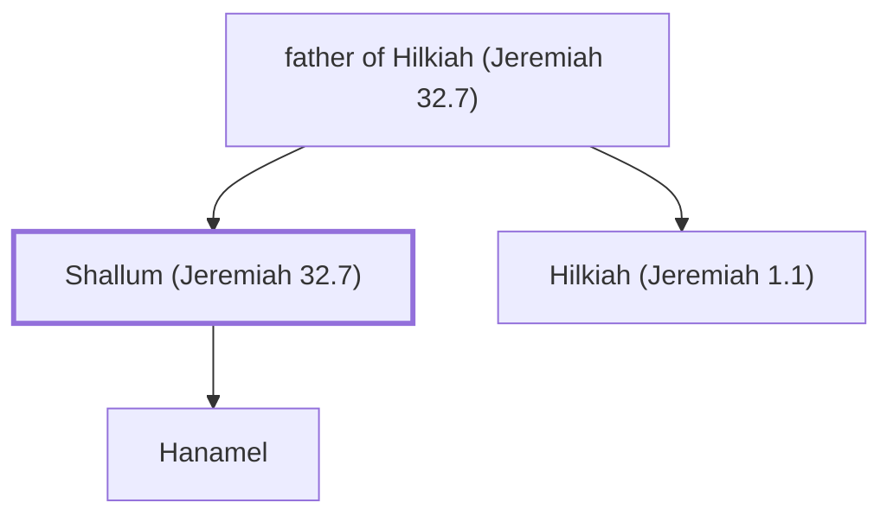

# Shallum (Jeremiah 32.7)

Uncle of Jeremiah the prophet

**Original-language names:** שַׁלּוּם (H7967)

## When

- **Placed around:** [[connections/timeline/6th century BC|589 BC]] *(Ussher: the median date of the passages naming them)*

## Family

- **Father:** [[connections/people/father of Hilkiah (Jeremiah 32.7)|father of Hilkiah (Jeremiah 32.7)]]
- **Brothers and sisters:** [[connections/people/Hilkiah (Jeremiah 1.1)|Hilkiah (Jeremiah 1.1)]]
- **Children:** [[connections/people/Hanamel|Hanamel]]

**Family group:** [[connections/genealogy/Family of father of Hilkiah (Jeremiah 32.7)|Family of father of Hilkiah (Jeremiah 32.7)]], generation 2

## Appears in

[[connections/chapters/24-jeremiah/Jeremiah 32|Jeremiah 32]]

## Appears in the same verse as

[[connections/people/Hanamel|Hanamel]] · [[connections/places/Anathoth|Anathoth]]
