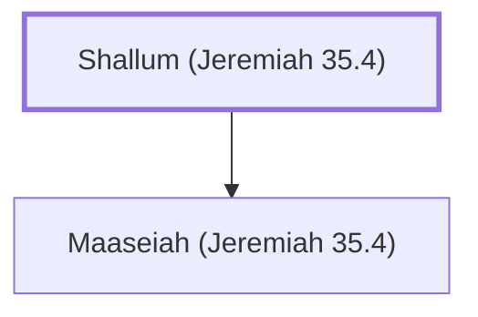

# Shallum (Jeremiah 35.4)

Father of Maaseiah, keeper of the threshold

**Original-language names:** שַׁלּוּם (H7967)

## When

- **Placed around:** [[connections/timeline/7th century BC|607 BC]] *(Ussher: the median date of the passages naming them)*

## Family

- **Children:** [[connections/people/Maaseiah (Jeremiah 35.4)|Maaseiah (Jeremiah 35.4)]]

**Family group:** [[connections/genealogy/Family of Shallum (Jeremiah 35.4)|Family of Shallum (Jeremiah 35.4)]], generation 1

## Appears in

[[connections/chapters/24-jeremiah/Jeremiah 35|Jeremiah 35]]

## Appears in the same verse as

[[connections/people/Hanan (Jeremiah 35.4)|Hanan (Jeremiah 35.4)]] · [[connections/people/Igdaliah|Igdaliah]] · [[connections/people/Maaseiah (Jeremiah 35.4)|Maaseiah (Jeremiah 35.4)]]
