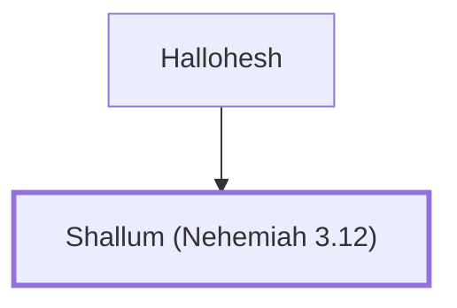

# Shallum (Nehemiah 3.12)

Son of Hallohesh, repaired a section of Jerusalem's wall

**Original-language names:** שַׁלּוּם (H7967)

## When

- **Placed around:** [[connections/timeline/5th century BC|445 BC]] *(Ussher: the median date of the passages naming them)*

## Family

- **Father:** [[connections/people/Hallohesh|Hallohesh]]

**Family group:** [[connections/genealogy/Family of Hallohesh|Family of Hallohesh]], generation 2

## Appears in

[[connections/chapters/16-nehemiah/Nehemiah 3|Nehemiah 3]]

## Appears in the same verse as

[[connections/people/Hallohesh|Hallohesh]] · [[connections/places/Jerusalem|Jerusalem]]
