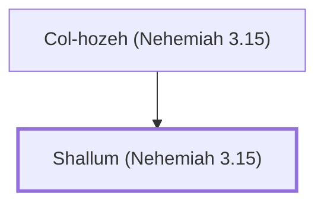

# Shallum (Nehemiah 3.15)

Son of Col-hozeh, repaired the Fountain Gate

**Original-language names:** שַׁלּוּן (H7968)

## When

- **Placed around:** [[connections/timeline/5th century BC|445 BC]] *(Ussher: the median date of the passages naming them)*

## Family

- **Father:** [[connections/people/Col-hozeh (Nehemiah 3.15)|Col-hozeh (Nehemiah 3.15)]]

**Family group:** [[connections/genealogy/Family of Col-hozeh (Nehemiah 3.15)|Family of Col-hozeh (Nehemiah 3.15)]], generation 2

## Appears in

[[connections/chapters/16-nehemiah/Nehemiah 3|Nehemiah 3]]

## Appears in the same verse as

[[connections/people/Col-hozeh (Nehemiah 3.15)|Col-hozeh (Nehemiah 3.15)]] · [[connections/people/David|David]] · [[connections/places/Fountain Gate|Fountain Gate]] · [[connections/places/Mizpah|Mizpah]] · [[connections/places/Shelah|Shelah]]
