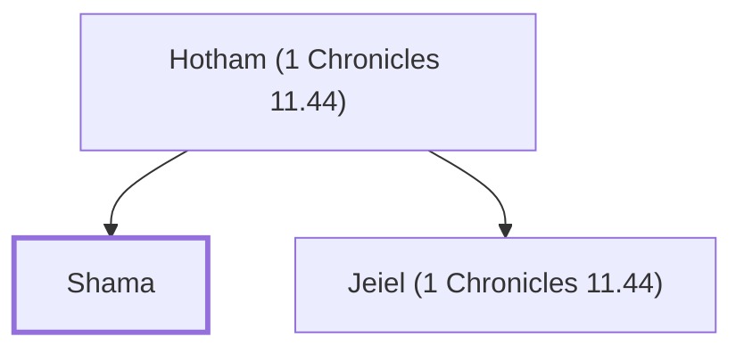

# Shama

Mighty man in David's army, a Harodite

**Original-language names:** שָׁמָע (H8091)

## When

- **Placed around:** [[connections/timeline/11th century BC|1055 BC]] *(Ussher: the median date of the passages naming them)*

## Family

- **Father:** [[connections/people/Hotham (1 Chronicles 11.44)|Hotham (1 Chronicles 11.44)]]
- **Brothers and sisters:** [[connections/people/Jeiel (1 Chronicles 11.44)|Jeiel (1 Chronicles 11.44)]]

**Family group:** [[connections/genealogy/Family of Hotham (1 Chronicles 11.44)|Family of Hotham (1 Chronicles 11.44)]], generation 2

## Appears in

[[connections/chapters/13-1-chronicles/1 Chronicles 11|1 Chronicles 11]]

## Appears in the same verse as

[[connections/people/Hotham (1 Chronicles 11.44)|Hotham (1 Chronicles 11.44)]] · [[connections/people/Jeiel (1 Chronicles 11.44)|Jeiel (1 Chronicles 11.44)]] · [[connections/people/Uzzia|Uzzia]]
