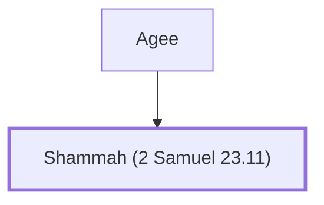

# Shammah (2 Samuel 23.11)

Mighty man in David's army, defended a lentil field

**Original-language names:** שַׁמָּא (H8037)

## When

- **Placed around:** [[connections/timeline/11th century BC|1055 BC]] *(Ussher: the median date of the passages naming them)*

## Family

- **Father:** [[connections/people/Agee|Agee]]

**Family group:** [[connections/genealogy/Family of Agee|Family of Agee]], generation 2

## Appears in

[[connections/chapters/10-2-samuel/2 Samuel 23|2 Samuel 23]]

## Appears in the same verse as

[[connections/people/Agee|Agee]] · [[connections/places/Lehi|Lehi]]
