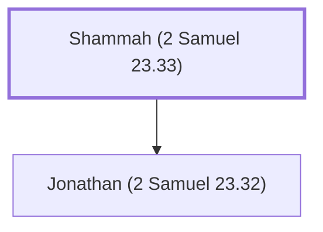

# Shammah (2 Samuel 23.33)

Mighty man in David's army, son of Agee the Hararite

**Also called:** Shagee

**Original-language names:** שַׁמָּה (H8048) · שָׁגֵה (H7681)

## When

- **Placed around:** [[connections/timeline/11th century BC|1055 BC]] *(Ussher: the median date of the passages naming them)*

## Family

- **Children:** [[connections/people/Jonathan (2 Samuel 23.32)|Jonathan (2 Samuel 23.32)]]

**Family group:** [[connections/genealogy/Family of Shammah (2 Samuel 23.33)|Family of Shammah (2 Samuel 23.33)]], generation 1

## Appears in

[[connections/chapters/10-2-samuel/2 Samuel 23|2 Samuel 23]] · [[connections/chapters/13-1-chronicles/1 Chronicles 11|1 Chronicles 11]]

## Appears in the same verse as

[[connections/people/Ahiam|Ahiam]] · [[connections/people/Hararites|Hararites]] · [[connections/people/Jashen|Jashen]] · [[connections/people/Jonathan (2 Samuel 23.32)|Jonathan (2 Samuel 23.32)]] · [[connections/people/Sharar|Sharar]]
