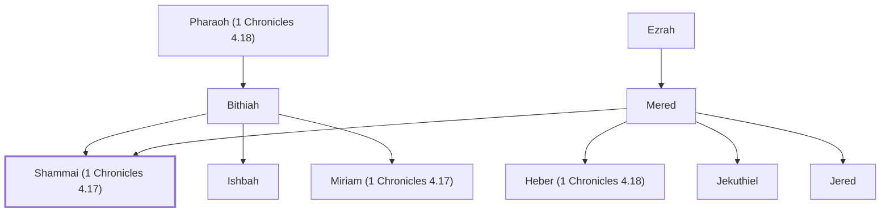

# Shammai (1 Chronicles 4.17)

Son of Mered

**Original-language names:** שַׁמַּי (H8060)

## When

- **Placed around:** [[connections/timeline/18th century BC|1721 BC]] *(Ussher: the median date of the passages naming them)*

## Family

- **Father:** [[connections/people/Mered|Mered (uncertain)]]
- **Mother:** [[connections/people/Bithiah|Bithiah]]
- **Brothers and sisters:** [[connections/people/Heber (1 Chronicles 4.18)|Heber (1 Chronicles 4.18) (uncertain)]], [[connections/people/Ishbah|Ishbah]], [[connections/people/Jekuthiel|Jekuthiel (uncertain)]], [[connections/people/Jered|Jered (uncertain)]], [[connections/people/Miriam (1 Chronicles 4.17)|Miriam (1 Chronicles 4.17)]]
- **Tribe or nation:** Tribe of Judah(?)

**Line of descent** (3 generations, father to son): [[connections/people/Ezrah|Ezrah]] → [[connections/people/Mered|Mered]] → **Shammai (1 Chronicles 4.17)**

**Family group:** [[connections/genealogy/Family of Adam|Family of Adam]], generation 3

## Appears in

[[connections/chapters/13-1-chronicles/1 Chronicles 4|1 Chronicles 4]]

## Appears in the same verse as

[[connections/people/Epher (1 Chronicles 4.17)|Epher (1 Chronicles 4.17)]] · [[connections/people/Ezrah|Ezrah]] · [[connections/people/Ishbah|Ishbah]] · [[connections/people/Jalon|Jalon]] · [[connections/people/Jether (1 Chronicles 4.17)|Jether (1 Chronicles 4.17)]] · [[connections/people/Mered|Mered]] · [[connections/people/Miriam (1 Chronicles 4.17)|Miriam (1 Chronicles 4.17)]] · [[connections/places/Eshtemoa|Eshtemoa]]
