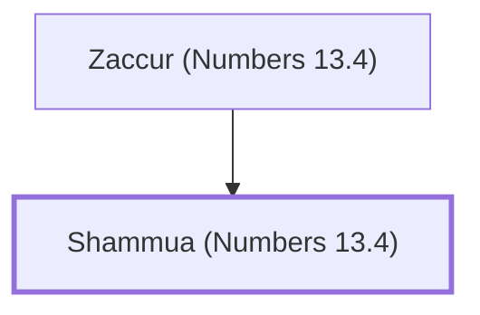

# Shammua (Numbers 13.4)

Spy from the tribe of Reuben

**Original-language names:** שַׁמּוּעַ (H8051)

## When

- **Placed around:** [[connections/timeline/15th century BC|1490 BC]] *(Ussher: the median date of the passages naming them)*

## Family

- **Father:** [[connections/people/Zaccur (Numbers 13.4)|Zaccur (Numbers 13.4)]]

**Family group:** [[connections/genealogy/Family of Zaccur (Numbers 13.4)|Family of Zaccur (Numbers 13.4)]], generation 2

## Appears in

[[connections/chapters/04-numbers/Numbers 13|Numbers 13]]

## Appears in the same verse as

[[connections/people/Reuben|Reuben]] · [[connections/people/Zaccur (Numbers 13.4)|Zaccur (Numbers 13.4)]]
