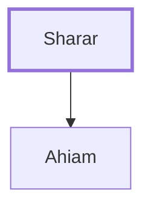

# Sharar

Father of Ahiam, one of David's mighty men

**Also called:** Sachar

**Original-language names:** שָׁרָר (H8325) · שָׂכָר (H7940)

## When

- **Placed around:** [[connections/timeline/11th century BC|1055 BC]] *(Ussher: the median date of the passages naming them)*

## Family

- **Children:** [[connections/people/Ahiam|Ahiam]]

**Family group:** [[connections/genealogy/Family of Sharar|Family of Sharar]], generation 1

## Appears in

[[connections/chapters/10-2-samuel/2 Samuel 23|2 Samuel 23]] · [[connections/chapters/13-1-chronicles/1 Chronicles 11|1 Chronicles 11]]

## Appears in the same verse as

[[connections/people/Ahiam|Ahiam (2)]] · [[connections/people/Eliphal|Eliphal]] · [[connections/people/Hararites|Hararites]] · [[connections/people/Shammah (2 Samuel 23.33)|Shammah (2 Samuel 23.33)]] · [[connections/people/Ur|Ur]]
