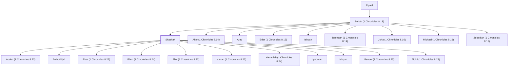

# Shashak

Benjamite leader and descendant of Elpaal

**Original-language names:** שָׁשָׁק (H8349)

## Family

- **Father:** [[connections/people/Beriah (1 Chronicles 8.13)|Beriah (1 Chronicles 8.13)]]
- **Brothers and sisters:** [[connections/people/Ahio (1 Chronicles 8.14)|Ahio (1 Chronicles 8.14)]], [[connections/people/Arad|Arad]], [[connections/people/Eder (1 Chronicles 8.15)|Eder (1 Chronicles 8.15)]], [[connections/people/Ishpah|Ishpah]], [[connections/people/Jeremoth (1 Chronicles 8.14)|Jeremoth (1 Chronicles 8.14)]], [[connections/people/Joha (1 Chronicles 8.16)|Joha (1 Chronicles 8.16)]], [[connections/people/Michael (1 Chronicles 8.16)|Michael (1 Chronicles 8.16)]], [[connections/people/Zebadiah (1 Chronicles 8.15)|Zebadiah (1 Chronicles 8.15)]]
- **Children:** [[connections/people/Abdon (1 Chronicles 8.23)|Abdon (1 Chronicles 8.23)]], [[connections/people/Anthothijah|Anthothijah]], [[connections/people/Eber (1 Chronicles 8.22)|Eber (1 Chronicles 8.22)]], [[connections/people/Elam (1 Chronicles 8.24)|Elam (1 Chronicles 8.24)]], [[connections/people/Eliel (1 Chronicles 8.22)|Eliel (1 Chronicles 8.22)]], [[connections/people/Hanan (1 Chronicles 8.23)|Hanan (1 Chronicles 8.23)]], [[connections/people/Hananiah (1 Chronicles 8.24)|Hananiah (1 Chronicles 8.24)]], [[connections/people/Iphdeiah|Iphdeiah]], [[connections/people/Ishpan|Ishpan]], [[connections/people/Penuel (1 Chronicles 8.25)|Penuel (1 Chronicles 8.25)]], [[connections/people/Zichri (1 Chronicles 8.23)|Zichri (1 Chronicles 8.23)]]
- **Tribe or nation:** Tribe of Benjamin

**Line of descent** (4 generations, father to son): [[connections/people/Shaharaim|Shaharaim]] → [[connections/people/Elpaal|Elpaal]] → [[connections/people/Beriah (1 Chronicles 8.13)|Beriah (1 Chronicles 8.13)]] → **Shashak**

**Family group:** [[connections/genealogy/Family of Shaharaim|Family of Shaharaim]], generation 4

## Appears in

[[connections/chapters/13-1-chronicles/1 Chronicles 8|1 Chronicles 8 (2)]]

## Appears in the same verse as

[[connections/people/Ahio (1 Chronicles 8.14)|Ahio (1 Chronicles 8.14)]] · [[connections/people/Iphdeiah|Iphdeiah]] · [[connections/people/Jeremoth (1 Chronicles 8.14)|Jeremoth (1 Chronicles 8.14)]] · [[connections/people/Penuel (1 Chronicles 8.25)|Penuel (1 Chronicles 8.25)]]
