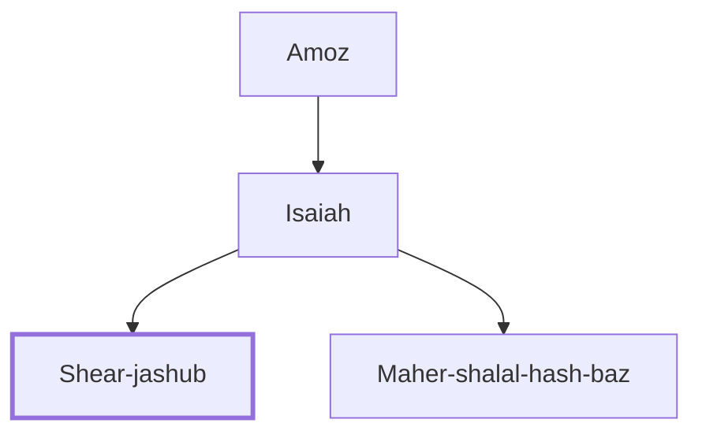

# Shear-jashub

Son of Isaiah the prophet

**Original-language names:** שְׁאָר יָשׁוּב (H7610)

## When

- **Placed around:** [[connections/timeline/8th century BC|741 BC]] *(Ussher: the median date of the passages naming them)*

## Family

- **Father:** [[connections/people/Isaiah|Isaiah]]
- **Brothers and sisters:** [[connections/people/Maher-shalal-hash-baz|Maher-shalal-hash-baz]]

**Line of descent** (3 generations, father to son): [[connections/people/Amoz|Amoz]] → [[connections/people/Isaiah|Isaiah]] → **Shear-jashub**

**Family group:** [[connections/genealogy/Family of Amoz|Family of Amoz]], generation 3

## Appears in

[[connections/chapters/23-isaiah/Isaiah 7|Isaiah 7]]

## Appears in the same verse as

[[connections/people/Ahaz (2 Kings 15.38)|Ahaz (2 Kings 15.38)]] · [[connections/people/Isaiah|Isaiah]] · [[connections/places/Washer's Field|Washer's Field]]
