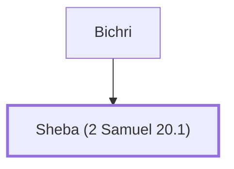

# Sheba (2 Samuel 20.1)

Benjamite rebel against King David

**Original-language names:** שֶׁ֫בַע (H7652a)

## When

- **Placed around:** [[connections/timeline/11th century BC|1022 BC]] *(Ussher: the median date of the passages naming them)*

## Family

- **Father:** [[connections/people/Bichri|Bichri]]
- **Tribe or nation:** Tribe of Benjamin

**Family group:** [[connections/genealogy/Family of Bichri|Family of Bichri]], generation 2

## Appears in

[[connections/chapters/10-2-samuel/2 Samuel 20|2 Samuel 20 (8)]]

## Appears in the same verse as

[[connections/people/Bichri|Bichri (8)]] · [[connections/people/Joab (1 Samuel 26.6)|Joab (1 Samuel 26.6) (5)]] · [[connections/people/David|David (4)]] · [[connections/places/Jerusalem|Jerusalem (3)]] · [[connections/people/Abishai|Abishai (2)]] · [[connections/people/Israel|Israel (2)]] · [[connections/people/Absalom|Absalom]] · [[connections/people/Amasa (2 Samuel 17.25)|Amasa (2 Samuel 17.25)]] · [[connections/people/Benjamin (Genesis 35.18)|Benjamin (Genesis 35.18)]] · [[connections/people/Ephraim|Ephraim]] · [[connections/people/Jesse|Jesse]] · [[connections/people/Judah (Genesis 29.35)|Judah (Genesis 29.35)]] · [[connections/places/Jordan|Jordan]]
