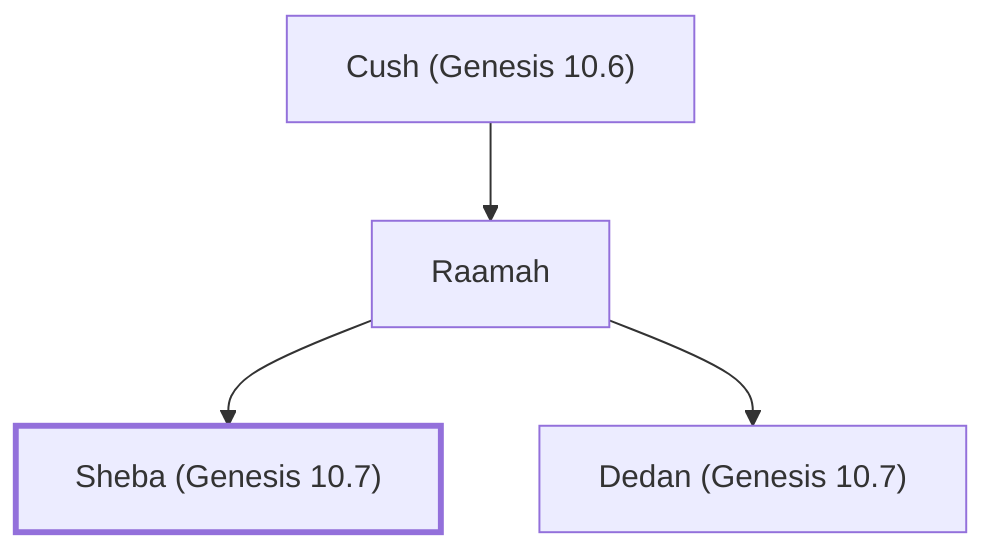

# Sheba (Genesis 10.7)

Descendants of Cush, known for wealth and trade

**Also called:** Sabean

**Original-language names:** שְׁבָא (H7614) · סְבָאִים (H5436)

## When

- **Placed around:** [[connections/timeline/16th century BC|1520 BC]] *(Ussher: the median date of the passages naming them)*

## Family

- **Father:** [[connections/people/Raamah|Raamah]]
- **Brothers and sisters:** [[connections/people/Dedan (Genesis 10.7)|Dedan (Genesis 10.7)]]
- **Tribe or nation:** Early Patriarch

**Line of descent** (14 generations, father to son): [[connections/people/Adam|Adam]] → [[connections/people/Seth|Seth]] → [[connections/people/Enosh|Enosh]] → [[connections/people/Kenan|Kenan]] → [[connections/people/Mahalalel (Genesis 5.12)|Mahalalel (Genesis 5.12)]] → [[connections/people/Jared|Jared]] → [[connections/people/Enoch (Genesis 5.18)|Enoch (Genesis 5.18)]] → [[connections/people/Methuselah|Methuselah]] → [[connections/people/Lamech (Genesis 5.25)|Lamech (Genesis 5.25)]] → [[connections/people/Noah (Genesis 5.29)|Noah (Genesis 5.29)]] → [[connections/people/Ham|Ham]] → [[connections/people/Cush (Genesis 10.6)|Cush (Genesis 10.6)]] → [[connections/people/Raamah|Raamah]] → **Sheba (Genesis 10.7)**

**Family group:** [[connections/genealogy/Family of Adam|Family of Adam]], generation 14

## Appears in

[[connections/chapters/01-genesis/Genesis 10|Genesis 10]] · [[connections/chapters/13-1-chronicles/1 Chronicles 1|1 Chronicles 1]] · [[connections/chapters/18-job/Job 1|Job 1]] · [[connections/chapters/26-ezekiel/Ezekiel 23|Ezekiel 23]]

## Appears in the same verse as

[[connections/people/Cush (Genesis 10.6)|Cush (Genesis 10.6) (2)]] · [[connections/people/Dedan (Genesis 10.7)|Dedan (Genesis 10.7) (2)]] · [[connections/people/Havilah (Genesis 10.7)|Havilah (Genesis 10.7) (2)]] · [[connections/people/Raamah|Raamah (2)]] · [[connections/people/Sabtah|Sabtah (2)]] · [[connections/people/Sabteca|Sabteca (2)]] · [[connections/people/Seba|Seba (2)]]
