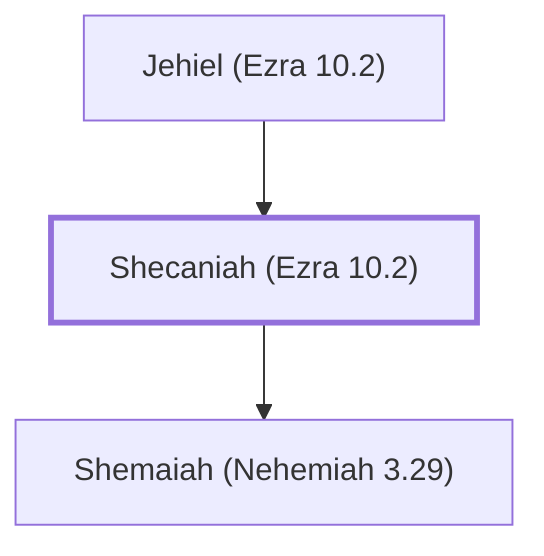

# Shecaniah (Ezra 10.2)

Israelite who confessed marrying a foreign wife

**Original-language names:** שְׁכַנְיָהוּ (H7935)

## When

- **Placed around:** [[connections/timeline/5th century BC|445 BC]] *(Ussher: the median date of the passages naming them)*

## Family

- **Father:** [[connections/people/Jehiel (Ezra 10.2)|Jehiel (Ezra 10.2)]]
- **Children:** [[connections/people/Shemaiah (Nehemiah 3.29)|Shemaiah (Nehemiah 3.29)]]

**Family group:** [[connections/genealogy/Family of Jehiel (Ezra 10.2)|Family of Jehiel (Ezra 10.2)]], generation 2

## Appears in

[[connections/chapters/15-ezra/Ezra 10|Ezra 10]] · [[connections/chapters/16-nehemiah/Nehemiah 3|Nehemiah 3]]

## Appears in the same verse as

[[connections/people/Elam (Ezra 2.7)|Elam (Ezra 2.7)]] · [[connections/people/Ezra (Ezra 7.1)|Ezra (Ezra 7.1)]] · [[connections/people/Immer (Nehemiah 3.29)|Immer (Nehemiah 3.29)]] · [[connections/people/Israel|Israel]] · [[connections/people/Jehiel (Ezra 10.2)|Jehiel (Ezra 10.2)]] · [[connections/people/Shemaiah (Nehemiah 3.29)|Shemaiah (Nehemiah 3.29)]] · [[connections/people/Zadok (Nehemiah 3.29)|Zadok (Nehemiah 3.29)]] · [[connections/places/East Gate|East Gate]]
