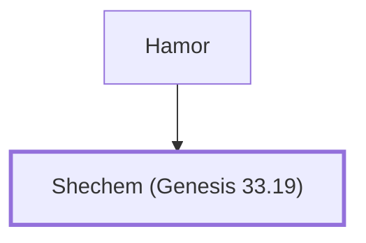

# Shechem (Genesis 33.19)

Founded the city where Dinah was raped

**Original-language names:** שְׁכֶם (H7927)

## When

- **Placed around:** [[connections/timeline/18th century BC|1732 BC]] *(Ussher: the median date of the passages naming them)*

## Family

- **Father:** [[connections/people/Hamor|Hamor]]

**Family group:** [[connections/genealogy/Family of Hamor|Family of Hamor]], generation 2

## Appears in

[[connections/chapters/01-genesis/Genesis 33|Genesis 33]] · [[connections/chapters/01-genesis/Genesis 34|Genesis 34 (10)]]

## Appears in the same verse as

[[connections/people/Hamor|Hamor (10)]] · [[connections/people/Dinah|Dinah (2)]] · [[connections/people/Israel|Israel (2)]]
