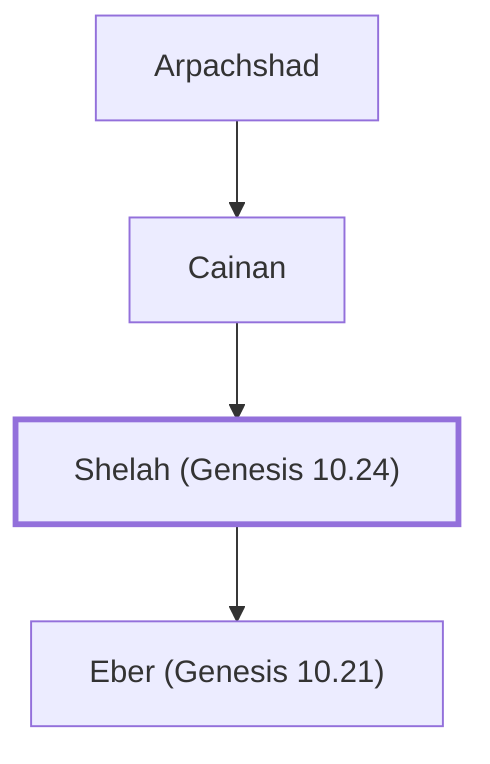

# Shelah (Genesis 10.24)

Son of Arpachshad and ancestor of Abraham

**Original-language names:** שֶׁ֫לַח (H7974) · Σαλά (G4527)

## When

- **Lived:** [[connections/timeline/24th century BC|2311 BC]] – [[connections/timeline/19th century BC|1878 BC]] *(Jones)*
- **Placed around:** [[connections/timeline/20th century BC|1908 BC]] *(Ussher: the median date of the passages naming them)*

## Family

- **Father:** [[connections/people/Cainan|Cainan]]
- **Children:** [[connections/people/Eber (Genesis 10.21)|Eber (Genesis 10.21)]]
- **Tribe or nation:** Early Patriarch

**Line of descent** (14 generations, father to son): [[connections/people/Adam|Adam]] → [[connections/people/Seth|Seth]] → [[connections/people/Enosh|Enosh]] → [[connections/people/Kenan|Kenan]] → [[connections/people/Mahalalel (Genesis 5.12)|Mahalalel (Genesis 5.12)]] → [[connections/people/Jared|Jared]] → [[connections/people/Enoch (Genesis 5.18)|Enoch (Genesis 5.18)]] → [[connections/people/Methuselah|Methuselah]] → [[connections/people/Lamech (Genesis 5.25)|Lamech (Genesis 5.25)]] → [[connections/people/Noah (Genesis 5.29)|Noah (Genesis 5.29)]] → [[connections/people/Shem|Shem]] → [[connections/people/Arpachshad|Arpachshad]] → [[connections/people/Cainan|Cainan]] → **Shelah (Genesis 10.24)**

**Family group:** [[connections/genealogy/Family of Adam|Family of Adam]], generation 14

## Events

- [[connections/timeline/24th century BC|2311 BC]] · [[connections/events/Birth of Salah|Birth of Salah]]
- [[connections/timeline/24th century BC|2311 BC]] · [[connections/events/Lifetime of Salah|Lifetime of Salah]]
- [[connections/timeline/23rd century BC|2281 BC]] · [[connections/events/Birth of Eber|Birth of Eber]]
- [[connections/timeline/19th century BC|1878 BC]] · [[connections/events/Death of Salah|Death of Salah]]

## Appears in

[[connections/chapters/01-genesis/Genesis 10|Genesis 10]] · [[connections/chapters/01-genesis/Genesis 11|Genesis 11 (4)]] · [[connections/chapters/13-1-chronicles/1 Chronicles 1|1 Chronicles 1 (2)]] · [[connections/chapters/42-luke/Luke 3|Luke 3]]

## Appears in the same verse as

[[connections/people/Arpachshad|Arpachshad (5)]] · [[connections/people/Eber (Genesis 10.21)|Eber (Genesis 10.21) (5)]] · [[connections/people/Peleg|Peleg]] · [[connections/people/Reu|Reu]] · [[connections/people/Serug|Serug]] · [[connections/people/Shem|Shem]]
