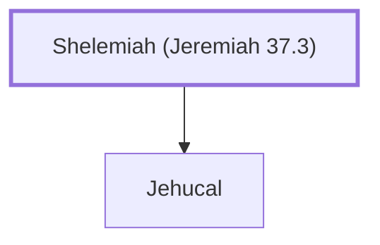

# Shelemiah (Jeremiah 37.3)

Priest during Zedekiah's reign

**Original-language names:** שֶׁלֶמְיָהוּ (H8018)

## When

- **Placed around:** [[connections/timeline/6th century BC|598 BC]] *(Ussher: the median date of the passages naming them)*

## Family

- **Children:** [[connections/people/Jehucal|Jehucal]]

**Family group:** [[connections/genealogy/Family of Shelemiah (Jeremiah 37.3)|Family of Shelemiah (Jeremiah 37.3)]], generation 1

## Appears in

[[connections/chapters/24-jeremiah/Jeremiah 37|Jeremiah 37]] · [[connections/chapters/24-jeremiah/Jeremiah 38|Jeremiah 38]]

## Appears in the same verse as

[[connections/people/Jehucal|Jehucal (2)]] · [[connections/people/Jeremiah (2 Chronicles 35.25)|Jeremiah (2 Chronicles 35.25) (2)]] · [[connections/people/Gedaliah (Jeremiah 38.1)|Gedaliah (Jeremiah 38.1)]] · [[connections/people/Maaseiah (Jeremiah 21.1)|Maaseiah (Jeremiah 21.1)]] · [[connections/people/Malchiah|Malchiah]] · [[connections/people/Mattan (Jeremiah 38.1)|Mattan (Jeremiah 38.1)]] · [[connections/people/Pashhur (Jeremiah 21.1)|Pashhur (Jeremiah 21.1)]] · [[connections/people/Pashhur (Jeremiah 38.1)|Pashhur (Jeremiah 38.1)]] · [[connections/people/Shephatiah (Jeremiah 38.1)|Shephatiah (Jeremiah 38.1)]] · [[connections/people/Zedekiah (2 Kings 24.17)|Zedekiah (2 Kings 24.17)]] · [[connections/people/Zephaniah (2 Kings 25.18)|Zephaniah (2 Kings 25.18)]]
