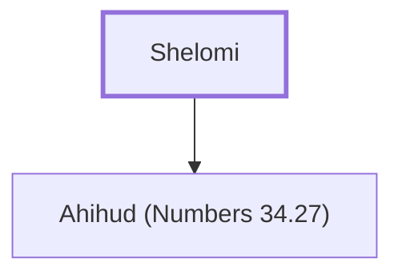

# Shelomi

Father of Ahihud, a leader from Asher

**Original-language names:** שְׁלֹמִי (H8015)

## When

- **Placed around:** [[connections/timeline/15th century BC|1452 BC]] *(Ussher: the median date of the passages naming them)*

## Family

- **Children:** [[connections/people/Ahihud (Numbers 34.27)|Ahihud (Numbers 34.27)]]

**Family group:** [[connections/genealogy/Family of Shelomi|Family of Shelomi]], generation 1

## Appears in

[[connections/chapters/04-numbers/Numbers 34|Numbers 34]]

## Appears in the same verse as

[[connections/people/Ahihud (Numbers 34.27)|Ahihud (Numbers 34.27)]] · [[connections/people/Asher|Asher]]
