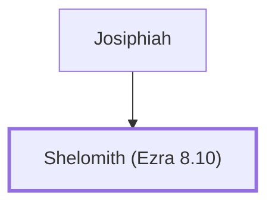

# Shelomith (Ezra 8.10)

Descendant of Bani who returned from exile

**Original-language names:** שְׁלֹמִית (H8019a)

## When

- **Placed around:** [[connections/timeline/5th century BC|457 BC]] *(Ussher: the median date of the passages naming them)*

## Family

- **Father:** [[connections/people/Josiphiah|Josiphiah]]

**Family group:** [[connections/genealogy/Family of Josiphiah|Family of Josiphiah]], generation 2

## Appears in

[[connections/chapters/15-ezra/Ezra 8|Ezra 8]]

## Appears in the same verse as

[[connections/people/Bani (Ezra 2.10)|Bani (Ezra 2.10)]] · [[connections/people/Josiphiah|Josiphiah]]
