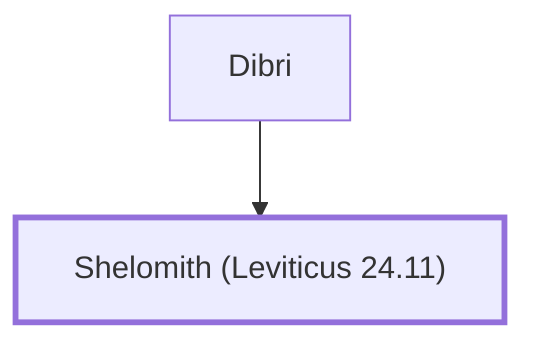

# Shelomith (Leviticus 24.11)

Mother of a blasphemer

**Original-language names:** שְׁלֹמִית (H8019b)

## When

- **Placed around:** [[connections/timeline/15th century BC|1490 BC]] *(Ussher: the median date of the passages naming them)*

## Family

- **Father:** [[connections/people/Dibri|Dibri]]

**Family group:** [[connections/genealogy/Family of Dibri|Family of Dibri]], generation 2

## Appears in

[[connections/chapters/03-leviticus/Leviticus 24|Leviticus 24]]

## Appears in the same verse as

[[connections/people/Dibri|Dibri]] · [[connections/people/Moses|Moses]] · [[connections/places/Dan|Dan]]
