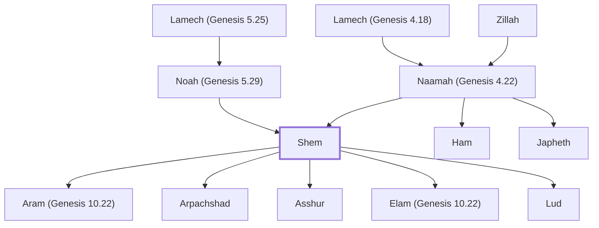

# Shem

Noah's son, ancestor of Semitic peoples

**Original-language names:** שֵׁם (H8035) · Σήμ (G4590)

## When

- **Lived:** [[connections/timeline/25th century BC|2446 BC]] – [[connections/timeline/19th century BC|1846 BC]] *(Jones)*
- **Placed around:** [[connections/timeline/24th century BC|2304 BC]] *(Ussher: the median date of the passages naming them)*

## Family

- **Father:** [[connections/people/Noah (Genesis 5.29)|Noah (Genesis 5.29)]]
- **Mother:** [[connections/people/Naamah (Genesis 4.22)|Naamah (Genesis 4.22) (uncertain)]]
- **Brothers and sisters:** [[connections/people/Ham|Ham]], [[connections/people/Japheth|Japheth]]
- **Children:** [[connections/people/Aram (Genesis 10.22)|Aram (Genesis 10.22)]], [[connections/people/Arpachshad|Arpachshad]], [[connections/people/Asshur|Asshur]], [[connections/people/Elam (Genesis 10.22)|Elam (Genesis 10.22)]], [[connections/people/Lud|Lud]]
- **Tribe or nation:** Early Patriarch

**Line of descent** (11 generations, father to son): [[connections/people/Adam|Adam]] → [[connections/people/Seth|Seth]] → [[connections/people/Enosh|Enosh]] → [[connections/people/Kenan|Kenan]] → [[connections/people/Mahalalel (Genesis 5.12)|Mahalalel (Genesis 5.12)]] → [[connections/people/Jared|Jared]] → [[connections/people/Enoch (Genesis 5.18)|Enoch (Genesis 5.18)]] → [[connections/people/Methuselah|Methuselah]] → [[connections/people/Lamech (Genesis 5.25)|Lamech (Genesis 5.25)]] → [[connections/people/Noah (Genesis 5.29)|Noah (Genesis 5.29)]] → **Shem**

**Family group:** [[connections/genealogy/Family of Adam|Family of Adam]], generation 11

## Events

- [[connections/timeline/25th century BC|2446 BC]] · [[connections/events/Birth of Shem|Birth of Shem]]
- [[connections/timeline/25th century BC|2446 BC]] · [[connections/events/Lifetime of Shem|Lifetime of Shem]]
- [[connections/timeline/24th century BC|2348 BC]] · [[connections/events/The Great Flood begins|The Great Flood begins]]
- [[connections/timeline/24th century BC|2348 BC]] · [[connections/events/The Great Flood|The Great Flood]]
- [[connections/timeline/24th century BC|2348 BC]] · [[connections/events/Water covers the earth|Water covers the earth]]
- [[connections/timeline/24th century BC|2347 BC]] · [[connections/events/The flood subsides|The flood subsides]]
- [[connections/timeline/24th century BC|2347 BC]] · [[connections/events/Leaving the Ark|Leaving the Ark]]
- [[connections/timeline/24th century BC|2346 BC]] · [[connections/events/Noah gets drunk and Canaan is cursed|Noah gets drunk and Canaan is cursed]]
- [[connections/timeline/24th century BC|2346 BC]] · [[connections/events/Birth of Arphaxad|Birth of Arphaxad]]
- [[connections/timeline/19th century BC|1846 BC]] · [[connections/events/Death of Shem|Death of Shem]]

## Appears in

[[connections/chapters/01-genesis/Genesis 5|Genesis 5]] · [[connections/chapters/01-genesis/Genesis 6|Genesis 6]] · [[connections/chapters/01-genesis/Genesis 7|Genesis 7]] · [[connections/chapters/01-genesis/Genesis 9|Genesis 9 (4)]] · [[connections/chapters/01-genesis/Genesis 10|Genesis 10 (4)]] · [[connections/chapters/01-genesis/Genesis 11|Genesis 11 (2)]] · [[connections/chapters/13-1-chronicles/1 Chronicles 1|1 Chronicles 1 (3)]] · [[connections/chapters/42-luke/Luke 3|Luke 3]]

## Appears in the same verse as

[[connections/people/Japheth|Japheth (9)]] · [[connections/people/Noah (Genesis 5.29)|Noah (Genesis 5.29) (7)]] · [[connections/people/Arpachshad|Arpachshad (6)]] · [[connections/people/Ham|Ham (6)]] · [[connections/people/Canaan|Canaan (3)]] · [[connections/people/Aram (Genesis 10.22)|Aram (Genesis 10.22) (2)]] · [[connections/people/Asshur|Asshur (2)]] · [[connections/people/Elam (Genesis 10.22)|Elam (Genesis 10.22) (2)]] · [[connections/people/Lud|Lud (2)]] · [[connections/people/Cainan|Cainan]] · [[connections/people/Eber (Genesis 10.21)|Eber (Genesis 10.21)]] · [[connections/people/Gether|Gether]] · [[connections/people/Hul|Hul]] · [[connections/people/Lamech (Genesis 5.25)|Lamech (Genesis 5.25)]] · [[connections/people/Mash|Mash]] · [[connections/people/Shelah (Genesis 10.24)|Shelah (Genesis 10.24)]] · [[connections/people/Uz (Genesis 10.23)|Uz (Genesis 10.23)]]
