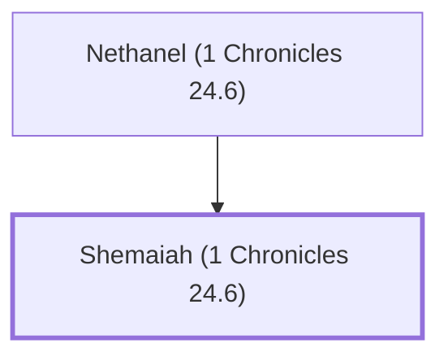

# Shemaiah (1 Chronicles 24.6)

Levite scribe during David's reign

**Original-language names:** שְׁמַעְיָ֫הוּ (H8098)

## When

- **Placed around:** [[connections/timeline/11th century BC|1015 BC]] *(Ussher: the median date of the passages naming them)*

## Family

- **Father:** [[connections/people/Nethanel (1 Chronicles 24.6)|Nethanel (1 Chronicles 24.6)]]

**Family group:** [[connections/genealogy/Family of Nethanel (1 Chronicles 24.6)|Family of Nethanel (1 Chronicles 24.6)]], generation 2

## Appears in

[[connections/chapters/13-1-chronicles/1 Chronicles 24|1 Chronicles 24]]

## Appears in the same verse as

[[connections/people/Abiathar|Abiathar]] · [[connections/people/Ahimelech (2 Samuel 8.17)|Ahimelech (2 Samuel 8.17)]] · [[connections/people/Eleazar (Exodus 6.23)|Eleazar (Exodus 6.23)]] · [[connections/people/Ithamar|Ithamar]] · [[connections/people/Nethanel (1 Chronicles 24.6)|Nethanel (1 Chronicles 24.6)]] · [[connections/people/Zadok (2 Samuel 8.17)|Zadok (2 Samuel 8.17)]]
