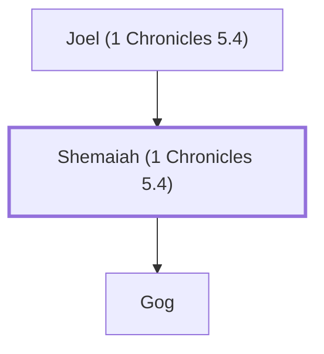

# Shemaiah (1 Chronicles 5.4)

Descendant of Reuben

**Original-language names:** שְׁמַעְיָ֫הוּ (H8098)

## When

- **Placed around:** [[connections/timeline/18th century BC|1710 BC]] *(Ussher: the median date of the passages naming them)*

## Family

- **Father:** [[connections/people/Joel (1 Chronicles 5.4)|Joel (1 Chronicles 5.4)]]
- **Children:** [[connections/people/Gog|Gog]]
- **Tribe or nation:** Tribe of Reuben

**Family group:** [[connections/genealogy/Family of Joel (1 Chronicles 5.4)|Family of Joel (1 Chronicles 5.4)]], generation 2

## Appears in

[[connections/chapters/13-1-chronicles/1 Chronicles 5|1 Chronicles 5]]

## Appears in the same verse as

[[connections/people/Gog|Gog]] · [[connections/people/Joel (1 Chronicles 5.4)|Joel (1 Chronicles 5.4)]] · [[connections/people/Shimei (1 Chronicles 5.4)|Shimei (1 Chronicles 5.4)]]
