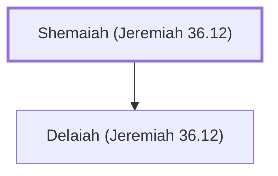

# Shemaiah (Jeremiah 36.12)

Scribe during Jehoiakim's reign

**Original-language names:** שְׁמַעְיָ֫הוּ (H8098)

## When

- **Placed around:** [[connections/timeline/7th century BC|606 BC]] *(Ussher: the median date of the passages naming them)*

## Family

- **Children:** [[connections/people/Delaiah (Jeremiah 36.12)|Delaiah (Jeremiah 36.12)]]

**Family group:** [[connections/genealogy/Family of Shemaiah (Jeremiah 36.12)|Family of Shemaiah (Jeremiah 36.12)]], generation 1

## Appears in

[[connections/chapters/24-jeremiah/Jeremiah 36|Jeremiah 36]]

## Appears in the same verse as

[[connections/people/Achbor (2 Kings 22.12)|Achbor (2 Kings 22.12)]] · [[connections/people/Delaiah (Jeremiah 36.12)|Delaiah (Jeremiah 36.12)]] · [[connections/people/Elishama (Jeremiah 36.12)|Elishama (Jeremiah 36.12)]] · [[connections/people/Elnathan (Jeremiah 26.22)|Elnathan (Jeremiah 26.22)]] · [[connections/people/Gemariah (Jeremiah 36.10)|Gemariah (Jeremiah 36.10)]] · [[connections/people/Hananiah (Jeremiah 36.12)|Hananiah (Jeremiah 36.12)]] · [[connections/people/Shaphan (2 Kings 22.3)|Shaphan (2 Kings 22.3)]] · [[connections/people/Zedekiah (Jeremiah 36.12)|Zedekiah (Jeremiah 36.12)]]
