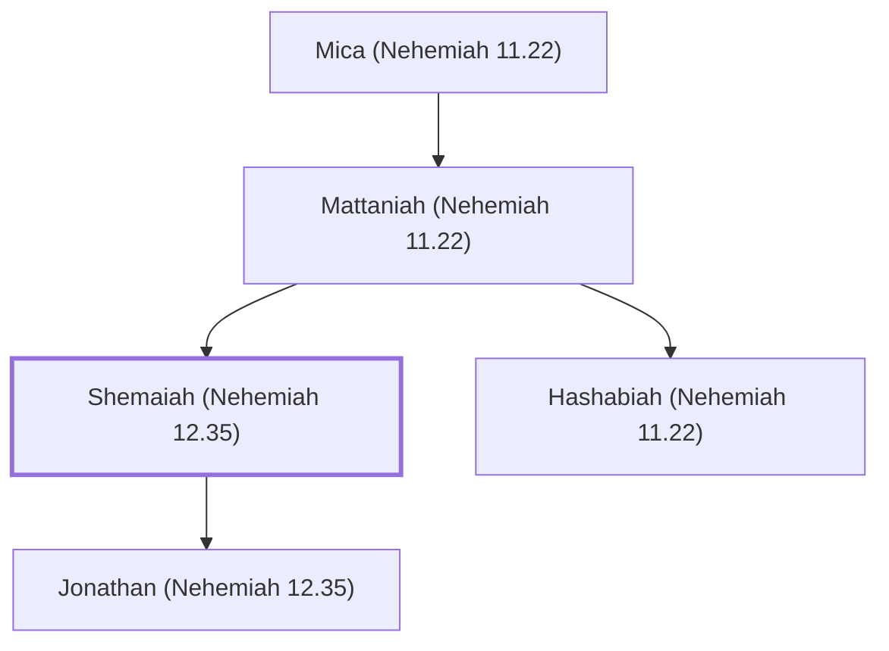

# Shemaiah (Nehemiah 12.35)

Priest who played a trumpet

**Original-language names:** שְׁמַעְיָ֫הוּ (H8098)

## When

- **Placed around:** [[connections/timeline/5th century BC|445 BC]] *(Ussher: the median date of the passages naming them)*

## Family

- **Father:** [[connections/people/Mattaniah (Nehemiah 11.22)|Mattaniah (Nehemiah 11.22)]]
- **Brothers and sisters:** [[connections/people/Hashabiah (Nehemiah 11.22)|Hashabiah (Nehemiah 11.22)]]
- **Children:** [[connections/people/Jonathan (Nehemiah 12.35)|Jonathan (Nehemiah 12.35)]]

**Line of descent** (3 generations, father to son): [[connections/people/Mica (Nehemiah 11.22)|Mica (Nehemiah 11.22)]] → [[connections/people/Mattaniah (Nehemiah 11.22)|Mattaniah (Nehemiah 11.22)]] → **Shemaiah (Nehemiah 12.35)**

**Family group:** [[connections/genealogy/Family of Mica (Nehemiah 11.22)|Family of Mica (Nehemiah 11.22)]], generation 3

## Appears in

[[connections/chapters/16-nehemiah/Nehemiah 12|Nehemiah 12]]

## Appears in the same verse as

[[connections/people/Asaph (1 Chronicles 6.24)|Asaph (1 Chronicles 6.24)]] · [[connections/people/Jonathan (Nehemiah 12.35)|Jonathan (Nehemiah 12.35)]] · [[connections/people/Mattaniah (Nehemiah 11.22)|Mattaniah (Nehemiah 11.22)]] · [[connections/people/Mica (Nehemiah 11.22)|Mica (Nehemiah 11.22)]] · [[connections/people/Zaccur (1 Chronicles 25.2)|Zaccur (1 Chronicles 25.2)]] · [[connections/people/Zechariah (Nehemiah 12.35)|Zechariah (Nehemiah 12.35)]]
