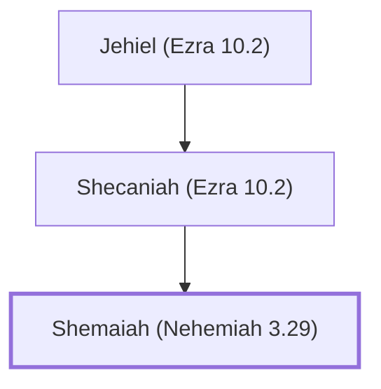

# Shemaiah (Nehemiah 3.29)

Levite who helped rebuild Jerusalem's wall

**Original-language names:** שְׁמַעְיָ֫הוּ (H8098)

## When

- **Placed around:** [[connections/timeline/5th century BC|445 BC]] *(Ussher: the median date of the passages naming them)*

## Family

- **Father:** [[connections/people/Shecaniah (Ezra 10.2)|Shecaniah (Ezra 10.2)]]

**Line of descent** (3 generations, father to son): [[connections/people/Jehiel (Ezra 10.2)|Jehiel (Ezra 10.2)]] → [[connections/people/Shecaniah (Ezra 10.2)|Shecaniah (Ezra 10.2)]] → **Shemaiah (Nehemiah 3.29)**

**Family group:** [[connections/genealogy/Family of Jehiel (Ezra 10.2)|Family of Jehiel (Ezra 10.2)]], generation 3

## Appears in

[[connections/chapters/16-nehemiah/Nehemiah 3|Nehemiah 3]]

## Appears in the same verse as

[[connections/people/Immer (Nehemiah 3.29)|Immer (Nehemiah 3.29)]] · [[connections/people/Shecaniah (Ezra 10.2)|Shecaniah (Ezra 10.2)]] · [[connections/people/Zadok (Nehemiah 3.29)|Zadok (Nehemiah 3.29)]] · [[connections/places/East Gate|East Gate]]
