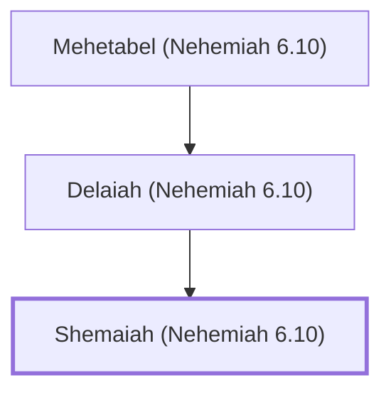

# Shemaiah (Nehemiah 6.10)

False prophet who opposed Nehemiah

**Original-language names:** שְׁמַעְיָ֫הוּ (H8098)

## When

- **Placed around:** [[connections/timeline/5th century BC|445 BC]] *(Ussher: the median date of the passages naming them)*

## Family

- **Father:** [[connections/people/Delaiah (Nehemiah 6.10)|Delaiah (Nehemiah 6.10)]]

**Line of descent** (3 generations, father to son): [[connections/people/Mehetabel (Nehemiah 6.10)|Mehetabel (Nehemiah 6.10)]] → [[connections/people/Delaiah (Nehemiah 6.10)|Delaiah (Nehemiah 6.10)]] → **Shemaiah (Nehemiah 6.10)**

**Family group:** [[connections/genealogy/Family of Mehetabel (Nehemiah 6.10)|Family of Mehetabel (Nehemiah 6.10)]], generation 3

## Appears in

[[connections/chapters/16-nehemiah/Nehemiah 6|Nehemiah 6]]

## Appears in the same verse as

[[connections/people/Delaiah (Nehemiah 6.10)|Delaiah (Nehemiah 6.10)]] · [[connections/people/Mehetabel (Nehemiah 6.10)|Mehetabel (Nehemiah 6.10)]]
